# Vectron POS — User Manual

**Version:** Phase 2+3 (multi-language + RTL)  
**Languages:** English · Français · العربية  
**Audience:** operators, managers, and administrators

---

## Table of contents

1. [Getting started](#1-getting-started)
2. [Login and operators](#2-login-and-operators)
3. [Order screen](#3-order-screen)
4. [Rooms, tables and floor plan](#4-rooms-tables-and-floor-plan)
5. [Payments](#5-payments)
6. [Order management](#6-order-management)
7. [Discounts, tips and fees](#7-discounts-tips-and-fees)
8. [Customers, loyalty and gift cards](#8-customers-loyalty-and-gift-cards)
9. [Stock and purchasing](#9-stock-and-purchasing)
10. [Staff: clock, shifts and payroll](#10-staff-clock-shifts-and-payroll)
11. [Kitchen display and 86 board](#11-kitchen-display-and-86-board)
12. [Reports](#12-reports)
13. [End of day (X / Z)](#13-end-of-day-x--z)
14. [Settings](#14-settings)
15. [Multi-language and Arabic RTL](#15-multi-language-and-arabic-rtl)
16. [Network, cloud and API](#16-network-cloud-and-api)
17. [Guest ordering, QR and kiosk](#17-guest-ordering-qr-and-kiosk)
18. [Troubleshooting](#18-troubleshooting)

---

## 1. Getting started

### System requirements
- Windows 10/11 (x64)
- Self-contained build: no separate .NET install needed
- Receipt printer (ESC/POS, port 9100), cash drawer, customer display — all optional
- LAN recommended for multi-terminal (main PC + order PCs)

### Launch
1. Run **Vectron POS.exe**.
2. The **shared database folder** (`client database`) must be reachable. On the first PC choose *Main PC* mode; on other terminals choose *Order PC* and point it at the Main PC path (e.g. `\\MAIN-PC\client database`).
3. The **login screen** appears.

### First-run setup
1. Log in as **Manager** (default PIN `1234`).
2. Open **Settings** and configure:
   - **Manage operators** — create staff, set roles and PINs
   - **Manage products / families** — build the menu
   - **Room management** — rooms and tables
   - **Printer routing** — which printer receives which ticket
   - **Currency and TVA** — currency symbol and tax rates
3. Toggle features on/off under each Settings category to match how you trade.

---

## 2. Login and operators

- The login screen lists every operator. Select a name (or use the dropdown), enter the **PIN**, press **Enter**.
- Roles: **Manager** (full access) and **Operator** (floor duties). Permissions (products, refunds, voids, settings, reports…) are granted per role.
- **Clock-in on login** (when enabled): the app records a shift start automatically. Clock out from **Operator** in the sidebar or at end of day.
- **Training mode**: sales are not recorded and a banner reminds you. Toggle it from Settings → Staff.

---

## 3. Order screen

The main screen has three zones: **menu (center)**, **category tabs (top)**, and the **current order (right)**.

### Adding items
- Tap a **category tab** (e.g. Popular, Mains, Drinks), then tap a **product tile** to add one to the order.
- Tap the **+** on a tile to add without leaving the tab.
- **Modifiers**: products with options open a modifier dialog — choose size, extras, etc.
- **Item notes**: long-press or use the note action to attach a kitchen note to a line.
- **Barcode**: click the scan field and scan a product barcode to add it instantly.

### The current-order panel
- Shows **operator, room, table, order type**, and seat buttons.
- **Seat**: assign lines to a seat when splitting by seat.
- Line controls: quantity, price, remove.
- **TOTAL** updates live.

### Seats
Tap **SEAT 1/2/3…** to attribute items to a guest. Useful for split-by-seat payment later.

---

## 4. Rooms, tables and floor plan

- Sidebar **Rooms** shows all rooms; each room contains tables.
- Tap a **table** to open its order. Occupied tables show the running total.
- **Table transfer**: move an open order to another table (Manager).
- **Split bill**: divide one table's order across seats, items, or custom amounts.
- **Hold / Fire** (Course management): send items to the kitchen now or hold them for a later course.
- **Floor plan editor** (Manager): drag tables, rename, resize, set capacity. The layout is stored per room.

---

## 5. Payments

### Taking payment
1. Tap **Take payment**.
2. Choose a **payment method** (Cash, Card, …). Methods are configurable under Settings → Payment.
3. **Cash**: enter tendered amount — the screen shows **TENDERED** and **CHANGE**. Quick-tender buttons (exact, 20, 50…) speed this up.
4. **Card**: confirm on the terminal, then accept. Virtual terminal mode can email an invoice link.
5. The sale is recorded and the **receipt prints** to the routed printer.

### Split payments
A ticket can be paid with **multiple methods** (e.g. part cash, part card). Each method prints its own receipt line and appears in the tender breakdown.

### Cash rounding
When enabled, totals round to the nearest 0.05 (configurable). The receipt shows a **ROUNDING** line.

### Special payment types
- **Tabs / Charge tabs**: open a customer tab, charge items over time, settle later (credit limits apply).
- **Deposits & special orders**: take a deposit now, collect goods later.
- **Offline card queue**: if the network is down, card sales queue and settle when back online.
- **Refunds**: Manager → select a past receipt → choose items → refund to original method. Stock is restocked automatically; a refund ticket prints to the Refund destination.

---

## 6. Order management

- **Park / Recall**: park an order to clear the screen; recall it from the parked list.
- **Repeat order**: duplicate the last ticket (takeaway regulars).
- **Order type**: Dine-in, Takeaway, Delivery, Kiosk — shown on the ticket and in reports.
- **Split bill**: by seat, by item, or custom amount.
- **Table transfer**: move orders between tables.
- **Course / Hold-Fire**: fire starters now, hold mains for a timed course.
- **Combo deals**: bundled products at a set price.
- **86 an item**: mark a product out of stock — it greys out on the menu and shows on the 86 board.

---

## 7. Discounts, tips and fees

- **Discounts**: percentage or fixed amount, per line or per ticket. Employee discount applies automatically for staff (percentage set in Settings → Staff).
- **Voids / Comps**: void a line before payment; comps mark items as free (both audited).
- **Service charge**: automatic % on dine-in (toggle).
- **Cash discount / Card surcharge**: adjust price by payment method.
- **Tips**: add a tip at payment; tips appear on the shift report and payroll export.
- **Happy hour**: scheduled automatic discounts by time/day — configure under Settings → Customers.

---

## 8. Customers, loyalty and gift cards

- **Customer database**: name, phone, email, notes. Attach a customer to a ticket for history and loyalty.
- **Loyalty**: customers earn points per purchase; redeem as discounts.
- **Gift cards**: sell, activate, check balance, redeem. Balances live in the shared database.
- **e-Gift email**: send a gift card by email at sale time.

---

## 9. Stock and purchasing

- **Stock levels**: each product has a stock quantity; sales decrement it.
- **Reorder point + low-stock banner**: the home screen warns when items fall below reorder level.
- **Stocktake**: count physical stock; the system computes variance with an audit trail.
- **Waste & expiry**: log waste (spoilage, breakage); reports show waste cost.
- **Transfers**: move stock between locations (multi-branch).
- **Suppliers**: manage vendor list; **Purchase Orders** — create, receive, cancel, email as PDF. Receiving adds stock.
- **Food cost**: product cost fields drive margin reports.
- **Barcode labels (Code 39)**: print shelf labels from the product catalog.
- **Weight-priced items**: scale entry prompt for kg items.
- **Product variants**: size/color variants with CSV import.

---

## 10. Staff: clock, shifts and payroll

- **Clock in/out**: at login (optional) or from the Operator screen.
- **Shift report**: hours worked, sales per operator, tips, discounts given.
- **Payroll export (CSV)**: hours × gross-pay rate, ready for accounting.
- **Employee discount**: set a per-operator discount %.
- **Scheduling** (when enabled): rota view for the week.

---

## 11. Kitchen display and 86 board

- **Kitchen Display (KDS)**: live ticket queue on a second screen. Shows elapsed time, late alarm (configurable minutes), and tap-to-bump.
- **86 board**: dedicated screen of out-of-stock items, auto-populated when stock hits zero or staff 86 an item.

---

## 12. Reports

Open **Settings → Reports** (Manager). Key reports:

| Report | What it shows |
|---|---|
| Sales (X / Z) | Totals for the day / period |
| Payment breakdown | Cash, card, voucher, tip totals |
| By operator / product / family | Performance breakdowns |
| Discount & void report | Who discounted/voided what, and why |
| Occupancy heatmap | Covers by hour and daypart |
| Menu engineering | Stars, plowhorses, puzzles, dogs (qty × margin) |
| Accounting export | CSV journal (QuickBooks / Xero compatible) |
| Server performance | Terminals ranked by uptime/sales |
| AI insights | Plain-language summary of the day's patterns |
| Live dashboard | Real-time KPIs while trading |

All CSV exports use **invariant-culture decimals** (safe for any spreadsheet locale).

---

## 13. End of day (X / Z)

1. **Settings → End day (X / Z)**.
2. **X report**: mid-day snapshot (does not close the day).
3. **Z report**: closes the day. Shows:
   - SUMMARY (gross, discounts, tips, net)
   - PAYMENT BREAKDOWN (per method)
   - BY OPERATOR / PRODUCT / FAMILY
4. **Cash-up**: count the drawer, system shows expected vs counted, records variance.
5. **Cloud backup**: if configured, the Z report auto-uploads a full-database backup to the head office.
6. Print or export the report.

---

## 14. Settings

Settings is organised into categories (left column):

| Category | Contains |
|---|---|
| **Management** | Operators, products, families |
| **Reports** | All reports and exports |
| **Network** | Cloud sync, API, webhooks, store ID |
| **Ordering Table** | Room management, floor plan, table features |
| **Payment Pricing** | Methods, rounding, fees, tabs, deposits |
| **Staff** | Clock, shifts, payroll, discounts, training mode |
| **Inventory Stock** | Stock, purchasing, suppliers, variants, labels |
| **Customers** | Database, loyalty, gift cards, happy hour |
| **Operations** | Branches, refunds, QR, kiosk, customer display |
| **Receipts Display** | Email/SMS, receipt search, multi-language |

- Use the **toggles** to switch features on/off — disabled features disappear from the UI.
- **Language switcher** (when Multi-language is on): English / Français / العربية — the app restarts to apply.
- **Done** returns to the order screen.

---

## 15. Multi-language and Arabic RTL

- Three languages ship built-in: **English**, **Français**, **العربية**.
- Switch in **Settings → Language**; the app saves and restarts.
- Currency symbol and date format follow the language (en-GB / fr-FR / ar-MA).
- **Arabic mode flips the entire layout (RTL)**: sidebar on the right, order panel on the left, menus mirrored.
- **What is never translated**: product names, family names, room/table names, payment-method labels, printer names — these are your business data.
- Receipts print in the currently selected language.

---

## 16. Network, cloud and API

### Multi-terminal
- One **Main PC** holds the database; **Order PCs** connect via the UNC path.
- Status light at bottom-left: `MAIN PC` / `ORDER PC` + print-server status.

### Cloud sync
- **Settings → Network**: set head-office URL, shared key, sync interval.
- **Push-only by default**: each store pushes completed sales; the head office does not overwrite local data.
- **Pull sales history**: fetch your own sales from head office (scope = mine).
- **Full-database backup vault**: End Day Z report auto-uploads a zip; manual *Upload backup now* available; 14-zip rotation at head office.
- **Restore from home**: download the latest backup zip, extract, restart.

### REST API
- Enable in Settings → Network; set an **API key**.
- Routes: `GET/POST /sync/sales`, `POST/GET /sync/backup`, health endpoint.
- **Sale webhooks**: POST a JSON payload to your URL on every completed sale.

---

## 17. Guest ordering, QR and kiosk

- **Guest URL**: a public link (e.g. `https://your/order`) shows the menu on the customer's phone.
- **QR codes**: print QR table labels — each table's QR opens the menu pre-attributed to that table.
- **Call waiter / order status**: guests can call staff or check order status from the QR page.
- **Kiosk mode**: fullscreen self-order, pay at counter — launch from Settings → Operations.
- **Customer display**: second screen facing the guest shows the running total and thank-you message.
- Guest orders appear on the main screen with a source badge and can be managed like any order.

---

## 18. Troubleshooting

| Symptom | Fix |
|---|---|
| Login rejected | Confirm the correct operator is selected; PINs are per-operator. Reset via Manager → Manage operators. |
| Printer not printing | Settings → Printer routing: check the destination points to the right Windows printer; print a test page. Print server must be running on the Main PC (status shown bottom-left). |
| Order PC can't see data | Verify the UNC path (`\\MAIN-PC\client database`) is reachable; firewall must allow SMB. |
| Language doesn't change | The switcher restarts the app — allow a few seconds. If it reverts, check Multi-language toggle is on. |
| Cloud sync failing | Settings → Network: check URL, key, and that the head-office server is reachable. Sync errors appear in the status line. |
| Sale missing from report | Check training mode is off (training sales are not recorded). Check the date filter on the report. |
| Cash drawer not opening | Drawer is triggered by the payment printer — confirm the printer supports drawer kick and the cable is connected. |
| App feels slow | Settings → Staff → Server performance shows per-terminal health; check disk space on the Main PC. |

---

---

# Part 2 — Complete Setup Guide (Step by Step)

*For restaurant managers: configure the app from zero to fully operational in 10 steps.*

> **How to open Settings:** from the main order screen, tap **Settings** in the left sidebar.  
> **Colour code on toggles:** 🟢 **Green = ON** · 🔴 **Red = OFF** · ⬛ **Dark grey = action button** (opens a dialog or runs a command).

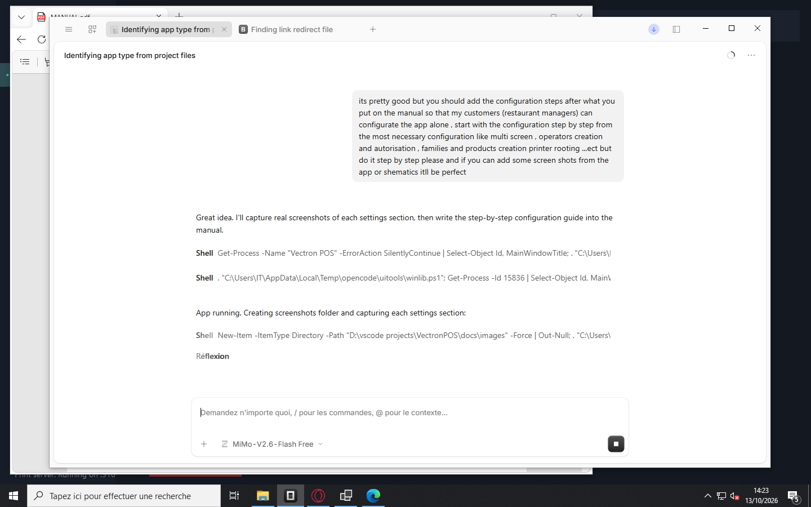

---

## Step 1 — Multi-screen setup (Main PC + Order PCs)

*Do this first if you have more than one terminal.*

Your restaurant has one **Main PC** (hosts the database) and any number of **Order PCs** (take orders, send to kitchen).

### On the Main PC
1. Open **Settings → Network settings**.
2. Select **Main PC (server) — hosts the database**.
3. Press **Save**.
4. Note the computer name shown at the bottom-left of the screen (e.g. `MAIN PC`) and its IP address.

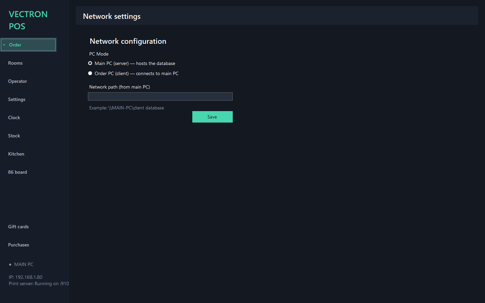

### On each Order PC
1. Install and launch Vectron POS on the second PC.
2. At the network screen (or **Settings → Network settings**), select **Order PC (client) — connects to main PC**.
3. In **Network path**, type the Main PC's shared folder, for example:
   ```
   \\MAIN-PC\client database
   ```
   Replace `MAIN-PC` with your Main PC's actual computer name.
4. Press **Save**. The app restarts and connects to the Main PC.

### Before you start
- Both PCs must be on the **same network** (same router / Wi-Fi).
- Windows file sharing (SMB) must be enabled on the Main PC.
- The status at bottom-left of the Main PC shows `MAIN PC`; Order PCs show `ORDER PC`.

---

## Step 2 — Create your operators (staff logins)

Every person who uses the till gets their own **operator** with a PIN and a role.

1. Open **Settings → Management → Manage operators**.
2. You will see the default operators (Manager, Cashier). Click **New operator**.
3. Fill in:
   - **Operator name** — e.g. `Sara`, `Ahmed`, `Waiter 1`
   - **Password (PIN)** — a 4-digit PIN (e.g. `1111`). Leave empty for no PIN.
   - **Hourly wage** — used for labour-cost reports and payroll export (optional).
4. Tick the **Permissions** this person should have:
   | Permission | Meaning |
   |---|---|
   | **Take payments** | Can process sales and take money |
   | **Discounts** | Can apply discounts / comps |
   | **Refunds** | Can refund past sales |
   | **View sales** | Can open sales reports |
   | **Manage products** | Can edit the product catalog |
   | **Manage rooms** | Can edit rooms / tables / floor plan |
5. Press **Save changes**.
6. Repeat for each staff member.

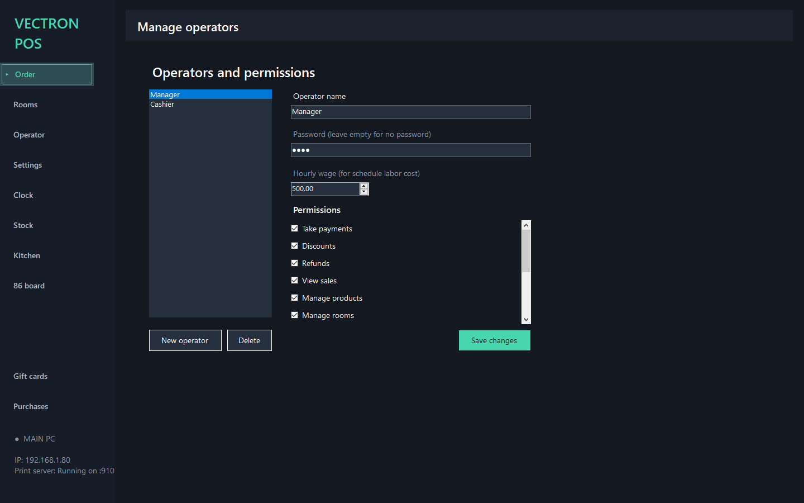

### Recommended setup
| Role | Permissions |
|---|---|
| **Manager** | All boxes ticked |
| **Cashier** | Take payments ✅ · View sales ✅ · rest ❌ |
| **Waiter** | Take payments ✅ · rest ❌ |
| **Kitchen** | No login needed — use Kitchen Display instead |

> **Tip:** give every waiter their own operator so sales and tips are tracked per person.

---

## Step 3 — Set currency and tax (TVA)

1. Open **Settings → Management → Currency and TVA**.
2. **Currency** — pick your currency from the list (EUR €, USD $, MAD, etc.).
3. **TVA rate (%)** — enter your standard tax rate (e.g. `20` for 20 %, `10` for Morocco's 10 %).
4. **Prices already include TVA** — tick this if the menu prices you enter are *tax-inclusive* (normal in restaurants). Leave unticked if prices are *before tax*.
5. Press **Save**.

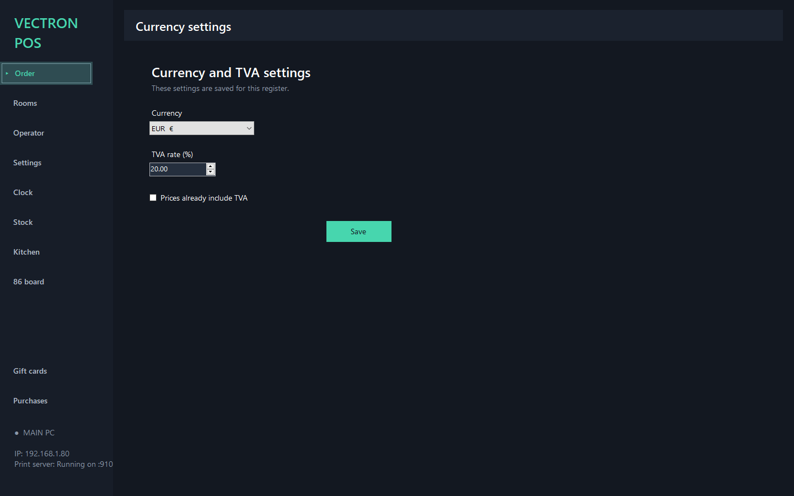

> All receipts and reports will now show the correct currency and tax.

---

## Step 4 — Create your families (menu categories)

**Families** are the tabs shown at the top of the order screen (Popular, Mains, Drinks…).

1. Open **Settings → Management → Manage families**.
2. You'll see default families (General, Food, Drinks, Desserts). To add your own:
   - Click **New family**.
   - **Family name** — e.g. `Starters`, `Pizzas`, `Hot drinks`, `Shakes`.
   - **Family image** *(optional)* — click **Import** and choose a picture. The tile on the order screen will show it.
   - **Print family to** — choose which printer receives this family's items (e.g. `Kitchen` for food, `Bar` for drinks). This is how kitchen tickets get routed automatically.
3. Press **Save changes**.
4. To assign existing products to this family: select a product in the list on the right, pick the family from the dropdown, press **Save changes**.

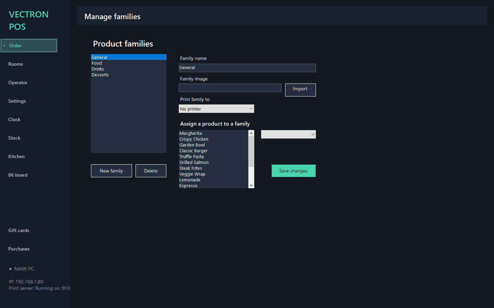

### Example family layout
| Family | Printed to |
|---|---|
| Starters | Kitchen |
| Mains | Kitchen |
| Desserts | Kitchen |
| Hot drinks | Bar |
| Cold drinks | Bar |
| Beers & wine | Bar |

---

## Step 5 — Create your products

1. Open **Settings → Management → Manage products**.
2. Click **New product**.
3. Fill in:
   - **Name** — e.g. `Margherita`, `Chicken Caesar`, `Cappuccino`
   - **Category** — pick the tab where it appears (Popular, Mains, Drinks…)
   - **Price** — sale price (tax rules from Step 3 apply automatically)
   - **Color** *(optional)* — tile colour on the order screen (click to pick)
   - **Image** *(optional)* — click **Import** to add a photo
   - **Barcode** — scan or type the product's barcode (for barcode scanning)
   - **Priced per kg** — tick only for weight-priced items (cheese, meat, candy)
4. Press **Save changes**.
5. Repeat for every product.

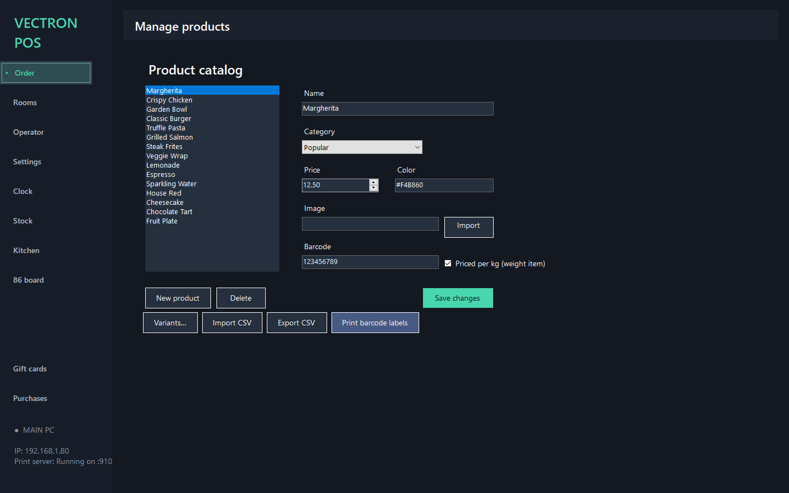

### Shortcuts
- **Import CSV** — bulk-import products from a spreadsheet (Name, Price, Category, Barcode columns).
- **Export CSV** — back up your catalog.
- **Variants…** — add size/color variants (e.g. Small / Medium / Large).
- **Print barcode labels** — print Code-39 shelf labels for your products.

> **Tip:** create families first (Step 4), then products — each product picks its family during creation.

---

## Step 6 — Set up rooms and tables

1. Open **Settings → Management → Room management**.
2. Default rooms (Main dining, Terrace, Private room) are listed. To edit:
   - **Rename** a room by typing in its text box.
   - **Table count** — set how many tables each room has (e.g. Main dining = 20).
3. Click **+ Add room** to create more (e.g. `Bar area`, `Garden`).
4. Press **Save changes**.

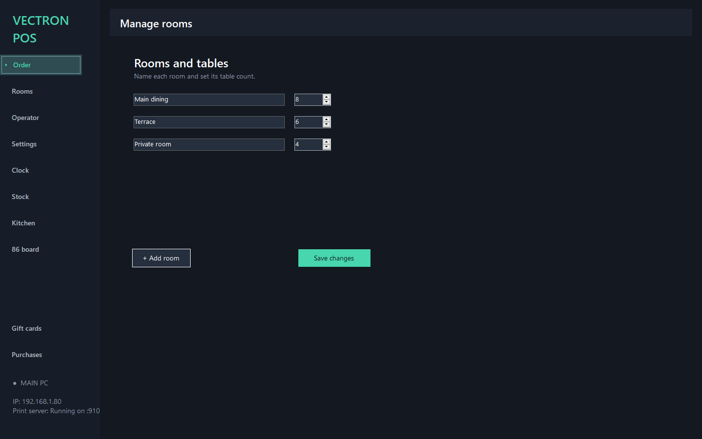

### Arrange tables on the floor plan
1. Go to **Rooms** in the left sidebar.
2. Tap a **room tab** at the top.
3. Each table is a tile — **drag** tiles to match your real layout.
4. Tap a table to open its order; the tile turns 🔴 **Taken** when occupied and returns to ⬪ **Available** when the bill is paid.

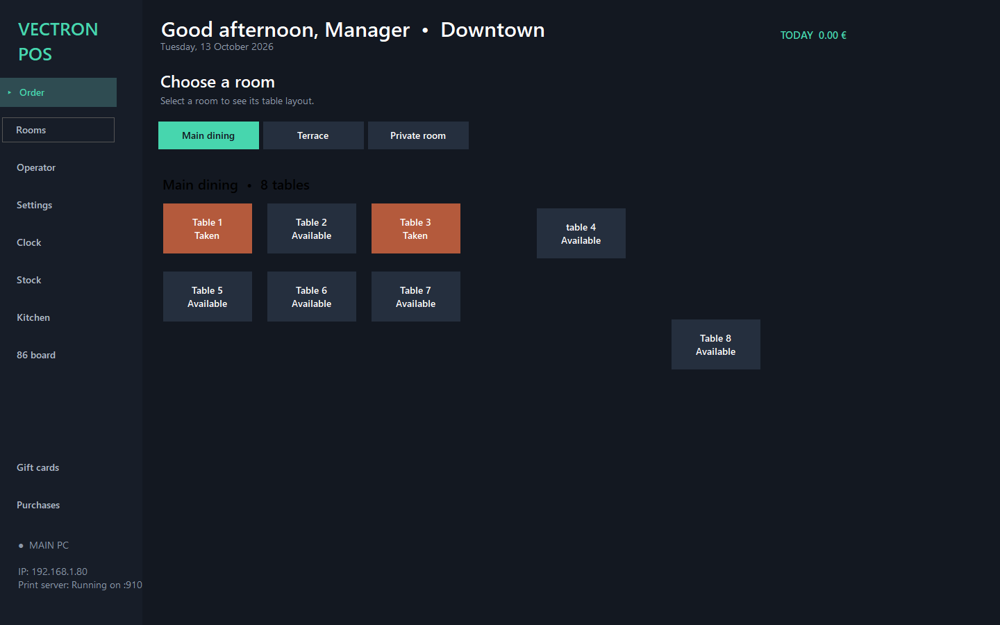

---

## Step 7 — Configure printers (Printer routing)

*This is the most important technical step — tickets must reach the right printer.*

1. Open **Settings → Management → Printer routing**.
2. You'll see default destinations: **Bill**, **Payment**, **Kitchen**, **Refund**, **Cancel**.
3. For each destination:
   - **Destination name** — keep or rename (e.g. `Kitchen 1`, `Bar`, `Receipt`).
   - **Windows printer** — pick the physical printer installed on this PC (e.g. `EPSON TM-T20`, `VLPT2`).
   - **Ticket template → Header** — first line printed (e.g. `KITCHEN ORDER`, `RECEIPT`).
   - **Ticket template → Footer** — last line (e.g. `Thank you!`).
   - **Activate cutter after last line** — tick if the printer has a paper cutter.
4. Click **New destination** to add more (e.g. `Bar printer`, `Grill station`).
5. Press **Save changes**.

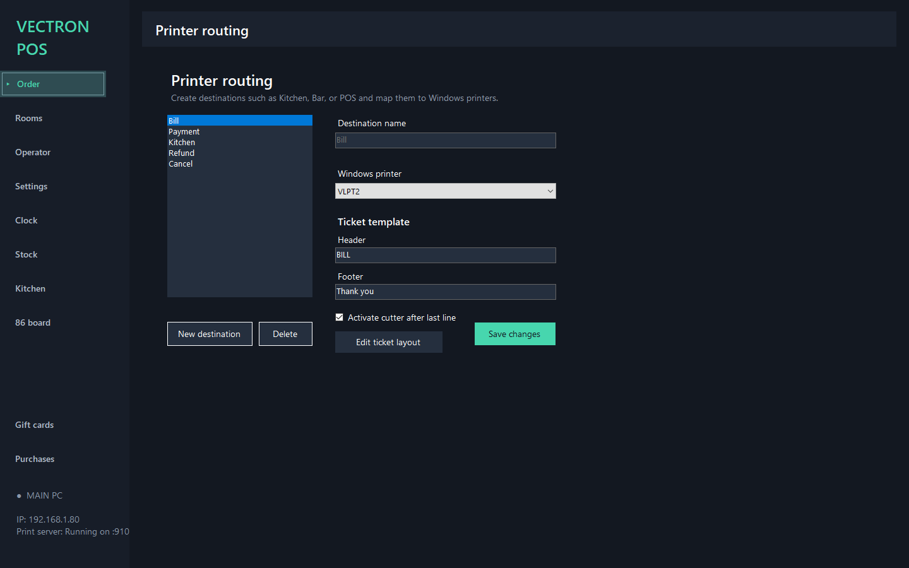

### Typical restaurant routing
| Destination | Printer | Purpose |
|---|---|---|
| **Bill** | Receipt printer (counter) | Customer bill |
| **Payment** | Receipt printer (counter) | Paid receipt |
| **Kitchen** | Kitchen printer | Food orders |
| **Bar** *(new)* | Bar printer | Drink orders |
| **Refund** | Receipt printer | Refund receipts |

### Test your printers
1. Print a Windows test page for each printer (Windows Settings → Printers).
2. In Vectron POS, take a test order and verify the kitchen ticket appears on the kitchen printer.
3. The bottom-left status should show **Print server: Running on :910**.

> **Edit ticket layout** — click this button to fine-tune what's printed (logo, room/table, seat, discount lines…).

---

## Step 8 — Enable payment & pricing features

Open **Settings → Payment Pricing**. Toggle features on/off (🟢 green = ON):

| Feature | What it does |
|---|---|
| **Discounts (% or fixed amount)** | Staff can discount lines / tickets |
| **Voids / comp meals** | Void before payment, comp items for VIPs |
| **Happy hour / timed pricing** | Automatic discounts at set times |
| **Tip management** | Add tips at payment; shown on shift report |
| **Multi-rate (dine-in / takeaway / delivery)** | Different prices per order type |
| **Cash drawer management** | Drawer kick on cash payment + no-sale log |
| **Round cash payments to nearest 5** | Round to 0.05 (handy in cash-heavy markets) |
| **Gift cards / store credit** | Sell & redeem gift cards |
| **Service charge %** | Auto-add service charge on dine-in |
| **Cash discount %** | Cash pays slightly less |
| **Card surcharge %** | Card pays slightly more |
| **Fees / terminal settings** | Per-method fee rules |

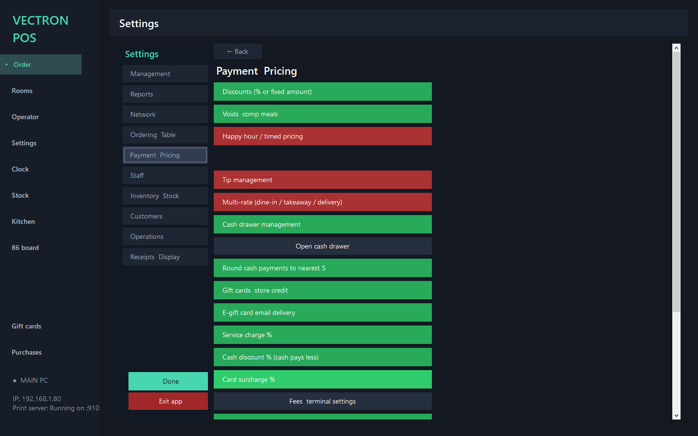

> Toggle OFF anything you don't use — it disappears from the UI and keeps the screen clean for staff.

---

## Step 9 — Staff settings

Open **Settings → Staff**:

| Feature | Recommended | Notes |
|---|---|---|
| **Clock in / out** | 🟢 ON | Staff clock in at login, out at end of shift |
| **Shift reports** | 🟢 ON | Hours + sales per operator |
| **Audit log** | 🟢 ON | Tracks who voided/refunded what |
| **Staff scheduling + tip pooling** | optional | Rota + shared tips |
| **Training mode** | 🔴 OFF for live | Practice without recording sales |
| **Employee discount %** | 🟢 ON | Set the % (e.g. 20) — applies to staff purchases |
| **PIN login** | 🟢 ON | Numeric PIN at startup |
| **Payroll export (CSV)** | 🟢 ON | Hours × wage → accounting |
| **Server performance** | 🟢 ON | Health dashboard |

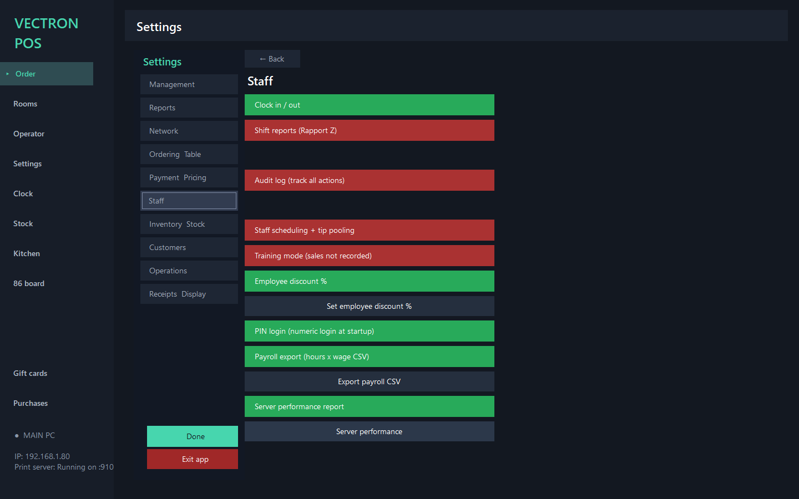

---

## Step 10 — Optional features & final checks

Open each remaining Settings category and switch on what you need:

### Ordering & Table
- Table transfer, split bill, hold/fire courses, park/recall orders, seat ordering.

### Inventory & Stock
- Stock tracking, low-stock alerts, stocktakes, waste tracking, purchase orders, suppliers, barcode labels.

### Customers
- Customer database, loyalty points, gift cards, happy hour.

### Operations
- Delivery orders, multi-branch, refunds, QR self-ordering, kiosk mode, customer display.

### Receipts & Display
- Email/SMS receipts, receipt search & reprint, multi-language (EN / FR / AR).

### Final checklist before opening
- [ ] Operators created with correct PINs and permissions
- [ ] Currency and TVA set correctly
- [ ] Families created and assigned to printers (Kitchen / Bar)
- [ ] All products entered with correct prices
- [ ] Rooms and tables configured; floor plan arranged
- [ ] Printers tested (bill + kitchen at minimum)
- [ ] Payment toggles match how you trade (cash discount? service charge?)
- [ ] Clock-in enabled; training mode OFF
- [ ] Multi-terminal tested (Order PC sees Main PC's data)
- [ ] End-of-day: run a **Z report** to verify totals

---

## Licensing

Each PC (Main PC + each Order PC) requires its own license. Licenses are issued by your supplier and bound to one machine.

### How to activate
1. Open **Settings → License**.
2. Click **Copy** next to your **Request code** (e.g. `REQ-A396-5417-972A-66C2`).
3. Send this request code to your supplier.
4. Your supplier issues a license key (e.g. `VECT-AGIVW2YR-2Q32HFSU-...`) valid for 1 year, 2 years, etc.
5. Paste the key into the **License key** field and click **Activate**.

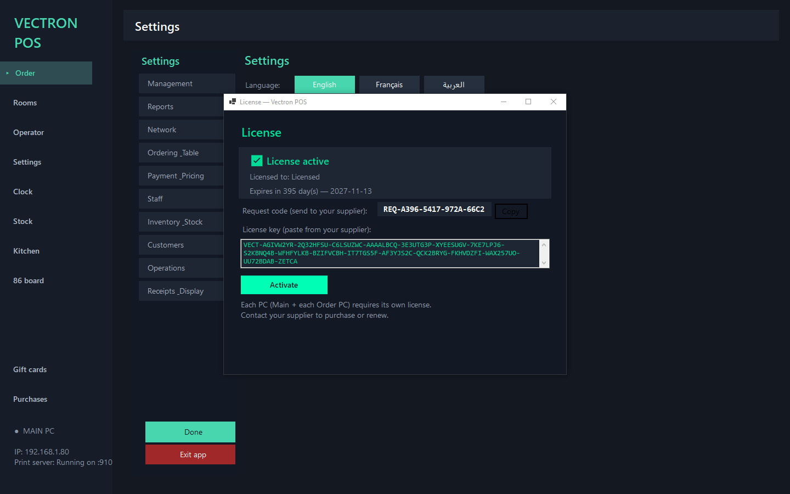

### License status
| Status | Meaning |
|---|---|
| ✅ **License active** | Valid — shows expiry date and days remaining |
| ⚠️ **Grace period** | Expired but still working — warning banner shown, renew soon |
| 🔴 **Expired** | Sales blocked — enter a new license key |
| 🔴 **Invalid** | Key doesn't match this PC — contact supplier |

### Important
- A license key works on **one PC only** — it's bound to that machine's hardware.
- If you replace a PC, contact your supplier for a new key.
- **3-PC restaurant** = 3 licenses (1 per terminal).
- Renewal: your supplier issues a new key with a new expiry date.

---

## Quick reference — Settings map

```
Settings
├── Management
│   ├── Manage operators      ← staff logins + permissions
│   ├── Manage families       ← menu categories + kitchen routing
│   ├── Manage products       ← items, prices, barcodes
│   ├── Room management       ← rooms + table counts
│   ├── Printer routing       ← bill / kitchen / bar printers
│   └── Currency and TVA      ← currency + tax rate
├── Reports                   ← all sales / performance reports
├── Network                   ← Main PC / Order PC, cloud sync
├── Ordering Table            ← split, transfer, courses, floor plan
├── Payment Pricing           ← discounts, tips, fees, rounding
├── Staff                     ← clock, shifts, payroll, training
├── Inventory Stock           ← stock, PO, suppliers, waste
├── Customers                 ← database, loyalty, gift cards, happy hour
├── Operations                ← branches, refunds, QR, kiosk, display
└── Receipts Display          ← email, receipt search, language
```

---

*Vectron POS — built for hospitality: fast floor service, honest reporting, three languages.*
