# Vectron POS — User Manual

**Version:** Phase 2+3 (multi-language + RTL)  
**Languages:** English · Français · العربية  
**Audience:** operators, managers, and administrators

---

## Table of contents

1. [Getting started](#1-getting-started)
2. [Login and operators](#2-login-and-operators)
3. [Order screen](#3-order-screen)
4. [Rooms, tables and floor plan](#4-rooms-tables-and-floor-plan)
5. [Payments](#5-payments)
6. [Order management](#6-order-management)
7. [Discounts, tips and fees](#7-discounts-tips-and-fees)
8. [Customers, loyalty and gift cards](#8-customers-loyalty-and-gift-cards)
9. [Stock and purchasing](#9-stock-and-purchasing)
10. [Staff: clock, shifts and payroll](#10-staff-clock-shifts-and-payroll)
11. [Kitchen display and 86 board](#11-kitchen-display-and-86-board)
12. [Reports](#12-reports)
13. [End of day (X / Z)](#13-end-of-day-x--z)
14. [Settings](#14-settings)
15. [Multi-language and Arabic RTL](#15-multi-language-and-arabic-rtl)
16. [Network, cloud and API](#16-network-cloud-and-api)
17. [Guest ordering, QR and kiosk](#17-guest-ordering-qr-and-kiosk)
18. [Troubleshooting](#18-troubleshooting)

**Guides:**
[⚡ Quick start — basic setup in 15 minutes](#quick-start--basic-setup-in-15-minutes) ·
[Part 2 — Complete setup guide](#part-2--complete-setup-guide-step-by-step) ·
[Part 3 — All features & configuration](#part-3--complete-feature-list--configuration-guide)

---

## Quick start — basic setup in 15 minutes

*The shortest path from a fresh install to your first paid sale on **one PC** — basic features only. No multi-terminal, no optional features. Each step is expandable in [Part 2](#part-2--complete-setup-guide-step-by-step) (full setup guide) and [Part 3](#part-3--complete-feature-list--configuration-guide) (every feature, configured step by step).*

### 1 · Launch and log in (1 min)
1. Run **Vectron POS.exe**. If the network screen appears, choose **Main PC (server)** → **Save**.
2. At the login screen pick **Manager** and press **Enter** (a fresh install has no PIN yet — set one later in *Settings → Manage operators*).

### 2 · Currency and tax (2 min)
1. **Settings → Currency and TVA**.
2. Set your **Currency**, your standard **TVA rate (%)**, and tick **Prices already include TVA** if your menu prices include tax (normal for restaurants).
3. **Save**.

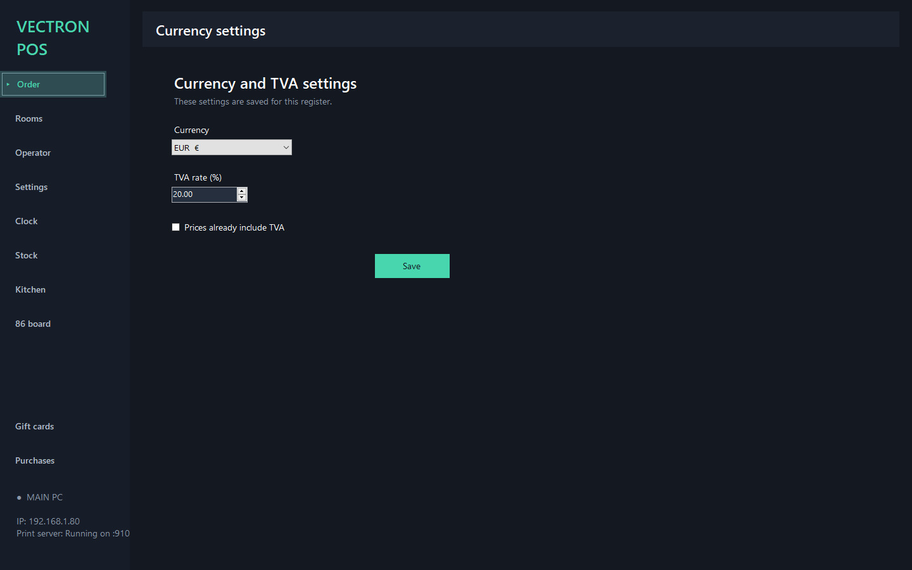

### 3 · Your first menu family (1 min)
1. **Settings → Manage families → New family** (e.g. `Food`, `Drinks`).
2. Give it a name; if you already installed a printer, set **Print family to** → `Kitchen` (food) or `Bar` (drinks).
3. **Save changes**.

### 4 · A handful of products (3 min)
1. **Settings → Manage products → New product**.
2. Fill **Name**, **Category** (the family from step 3), **Price** → **Save changes**.
3. Repeat until you have your 5–10 best sellers. (CSV import exists for full menus — see Part 3.)

### 5 · Rooms and tables (2 min)
1. **Settings → Room management** → set the **table count** per room, rename rooms, **+ Add room** if needed → **Save changes**.
2. Sidebar **Rooms** → drag the table tiles so the screen matches your real floor.

### 6 · Printer (2 min)
1. **Settings → Printer routing** → for **Bill** and **Kitchen** pick your Windows printer → **Save changes**.
2. Print a Windows test page first (Windows → Printers) if unsure.
3. Take a test order and confirm the kitchen ticket lands on the right printer.

### 7 · First order and payment (3 min)
1. Sidebar **Order** → tap a **category tab** → tap **product tiles** — lines appear on the right with a live **TOTAL**.
2. For dine-in: sidebar **Rooms** → tap a **table first**, then add items to it.
3. **Take payment → Cash** → enter the **tendered** amount → the **CHANGE** shows → accept. The receipt prints and the table turns free.

### 8 · Close the day (1 min)
At closing: **Settings → End day (X / Z) → Z report** — totals, payment breakdown, then cash-up the drawer.

**✅ You are open for business.**

**Next steps:** [Part 2](#part-2--complete-setup-guide-step-by-step) for multi-terminal + advanced setup · [Part 3](#part-3--complete-feature-list--configuration-guide) to switch on loyalty, stock, QR self-ordering, waiter tablets, KDS, happy hour and ~75 other features.

---

## 1. Getting started

### System requirements
- Windows 10/11 (x64)
- Self-contained build: no separate .NET install needed
- Receipt printer (ESC/POS, port 9100), cash drawer, customer display — all optional
- LAN recommended for multi-terminal (main PC + order PCs)

### Launch
1. Run **Vectron POS.exe**.
2. The **shared database folder** (`client database`) must be reachable. On the first PC choose *Main PC* mode; on other terminals choose *Order PC* and point it at the Main PC path (e.g. `\\MAIN-PC\client database`).
3. The **login screen** appears.

### First-run setup
1. Log in as **Manager** (default PIN `1234`).
2. Open **Settings** and configure:
   - **Manage operators** — create staff, set roles and PINs
   - **Manage products / families** — build the menu
   - **Room management** — rooms and tables
   - **Printer routing** — which printer receives which ticket
   - **Currency and TVA** — currency symbol and tax rates
3. Toggle features on/off under each Settings category to match how you trade.

---

## 2. Login and operators

- The login screen lists every operator. Select a name (or use the dropdown), enter the **PIN**, press **Enter**.
- Roles: **Manager** (full access) and **Operator** (floor duties). Permissions (products, refunds, voids, settings, reports…) are granted per role.
- **Clock-in on login** (when enabled): the app records a shift start automatically. Clock out from **Operator** in the sidebar or at end of day.
- **Training mode**: sales are not recorded and a banner reminds you. Toggle it from Settings → Staff.

---

## 3. Order screen

The main screen has three zones: **menu (center)**, **category tabs (top)**, and the **current order (right)**.

### Adding items
- Tap a **category tab** (e.g. Popular, Mains, Drinks), then tap a **product tile** to add one to the order.
- Tap the **+** on a tile to add without leaving the tab.
- **Modifiers**: products with options open a modifier dialog — choose size, extras, etc.
- **Item notes**: long-press or use the note action to attach a kitchen note to a line.
- **Barcode**: click the scan field and scan a product barcode to add it instantly.

### The current-order panel
- Shows **operator, room, table, order type**, and seat buttons.
- **Seat**: assign lines to a seat when splitting by seat.
- Line controls: quantity, price, remove.
- **TOTAL** updates live.

### Seats
Tap **SEAT 1/2/3…** to attribute items to a guest. Useful for split-by-seat payment later.

---

## 4. Rooms, tables and floor plan

- Sidebar **Rooms** shows all rooms; each room contains tables.
- Tap a **table** to open its order. Occupied tables show the running total.
- **Table transfer**: move an open order to another table (Manager).
- **Split bill**: divide one table's order across seats, items, or custom amounts.
- **Hold / Fire** (Course management): send items to the kitchen now or hold them for a later course.
- **Floor plan editor** (Manager): drag tables, rename, resize, set capacity. The layout is stored per room.

---

## 5. Payments

### Taking payment
1. Tap **Take payment**.
2. Choose a **payment method** (Cash, Card, …). Methods are configurable under Settings → Payment.
3. **Cash**: enter tendered amount — the screen shows **TENDERED** and **CHANGE**. Quick-tender buttons (exact, 20, 50…) speed this up.
4. **Card**: confirm on the terminal, then accept. Virtual terminal mode can email an invoice link.
5. The sale is recorded and the **receipt prints** to the routed printer.

### Split payments
A ticket can be paid with **multiple methods** (e.g. part cash, part card). Each method prints its own receipt line and appears in the tender breakdown.

### Cash rounding
When enabled, totals round to the nearest 0.05 (configurable). The receipt shows a **ROUNDING** line.

### Special payment types
- **Tabs / Charge tabs**: open a customer tab, charge items over time, settle later (credit limits apply).
- **Deposits & special orders**: take a deposit now, collect goods later.
- **Offline card queue**: if the network is down, card sales queue and settle when back online.
- **Refunds**: Manager → select a past receipt → choose items → refund to original method. Stock is restocked automatically; a refund ticket prints to the Refund destination.

---

## 6. Order management

- **Park / Recall**: park an order to clear the screen; recall it from the parked list.
- **Repeat order**: duplicate the last ticket (takeaway regulars).
- **Order type**: Dine-in, Takeaway, Delivery, Kiosk — shown on the ticket and in reports.
- **Split bill**: by seat, by item, or custom amount.
- **Table transfer**: move orders between tables.
- **Course / Hold-Fire**: fire starters now, hold mains for a timed course.
- **Combo deals**: bundled products at a set price.
- **86 an item**: mark a product out of stock — it greys out on the menu and shows on the 86 board.

---

## 7. Discounts, tips and fees

- **Discounts**: percentage or fixed amount, per line or per ticket. Employee discount applies automatically for staff (percentage set in Settings → Staff).
- **Voids / Comps**: void a line before payment; comps mark items as free (both audited).
- **Service charge**: automatic % on dine-in (toggle).
- **Cash discount / Card surcharge**: adjust price by payment method.
- **Tips**: add a tip at payment; tips appear on the shift report and payroll export.
- **Happy hour**: scheduled automatic discounts by time/day — configure under Settings → Customers.

---

## 8. Customers, loyalty and gift cards

- **Customer database**: name, phone, email, notes. Attach a customer to a ticket for history and loyalty.
- **Loyalty**: customers earn points per purchase; redeem as discounts.
- **Gift cards**: sell, activate, check balance, redeem. Balances live in the shared database.
- **e-Gift email**: send a gift card by email at sale time.

---

## 9. Stock and purchasing

- **Stock levels**: each product has a stock quantity; sales decrement it.
- **Reorder point + low-stock banner**: the home screen warns when items fall below reorder level.
- **Stocktake**: count physical stock; the system computes variance with an audit trail.
- **Waste & expiry**: log waste (spoilage, breakage); reports show waste cost.
- **Transfers**: move stock between locations (multi-branch).
- **Suppliers**: manage vendor list; **Purchase Orders** — create, receive, cancel, email as PDF. Receiving adds stock.
- **Food cost**: product cost fields drive margin reports.
- **Barcode labels (Code 39)**: print shelf labels from the product catalog.
- **Weight-priced items**: scale entry prompt for kg items.
- **Product variants**: size/color variants with CSV import.

---

## 10. Staff: clock, shifts and payroll

- **Clock in/out**: at login (optional) or from the Operator screen.
- **Shift report**: hours worked, sales per operator, tips, discounts given.
- **Payroll export (CSV)**: hours × gross-pay rate, ready for accounting.
- **Employee discount**: set a per-operator discount %.
- **Scheduling** (when enabled): rota view for the week.

---

## 11. Kitchen display and 86 board

- **Kitchen Display (KDS)**: live ticket queue on a second screen. Shows elapsed time, late alarm (configurable minutes), and tap-to-bump.
- **86 board**: dedicated screen of out-of-stock items, auto-populated when stock hits zero or staff 86 an item.

---

## 12. Reports

Open **Settings → Reports** (Manager). Key reports:

| Report | What it shows |
|---|---|
| Sales (X / Z) | Totals for the day / period |
| Payment breakdown | Cash, card, voucher, tip totals |
| By operator / product / family | Performance breakdowns |
| Discount & void report | Who discounted/voided what, and why |
| Occupancy heatmap | Covers by hour and daypart |
| Menu engineering | Stars, plowhorses, puzzles, dogs (qty × margin) |
| Accounting export | CSV journal (QuickBooks / Xero compatible) |
| Server performance | Terminals ranked by uptime/sales |
| AI insights | Plain-language summary of the day's patterns |
| Live dashboard | Real-time KPIs while trading |

All CSV exports use **invariant-culture decimals** (safe for any spreadsheet locale).

---

## 13. End of day (X / Z)

1. **Settings → End day (X / Z)**.
2. **X report**: mid-day snapshot (does not close the day).
3. **Z report**: closes the day. Shows:
   - SUMMARY (gross, discounts, tips, net)
   - PAYMENT BREAKDOWN (per method)
   - BY OPERATOR / PRODUCT / FAMILY
4. **Cash-up**: count the drawer, system shows expected vs counted, records variance.
5. **Cloud backup**: if configured, the Z report auto-uploads a full-database backup to the head office.
6. Print or export the report.

---

## 14. Settings

Settings is organised into categories (left column):

| Category | Contains |
|---|---|
| **Management** | Operators, products, families |
| **Reports** | All reports and exports |
| **Network** | Cloud sync, API, webhooks, store ID |
| **Ordering Table** | Room management, floor plan, table features |
| **Payment Pricing** | Methods, rounding, fees, tabs, deposits |
| **Staff** | Clock, shifts, payroll, discounts, training mode |
| **Inventory Stock** | Stock, purchasing, suppliers, variants, labels |
| **Customers** | Database, loyalty, gift cards, happy hour |
| **Operations** | Branches, refunds, QR, kiosk, customer display |
| **Receipts Display** | Email/SMS, receipt search, multi-language |

- Use the **toggles** to switch features on/off — disabled features disappear from the UI.
- **Language switcher** (when Multi-language is on): English / Français / العربية — the app restarts to apply.
- **Done** returns to the order screen.

---

## 15. Multi-language and Arabic RTL

- Three languages ship built-in: **English**, **Français**, **العربية**.
- Switch in **Settings → Language**; the app saves and restarts.
- Currency symbol and date format follow the language (en-GB / fr-FR / ar-MA).
- **Arabic mode flips the entire layout (RTL)**: sidebar on the right, order panel on the left, menus mirrored.
- **What is never translated**: product names, family names, room/table names, payment-method labels, printer names — these are your business data.
- Receipts print in the currently selected language.

---

## 16. Network, cloud and API

### Multi-terminal
- One **Main PC** holds the database; **Order PCs** connect via the UNC path.
- Status light at bottom-left: `MAIN PC` / `ORDER PC` + print-server status.

### Cloud sync
- **Settings → Network**: set head-office URL, shared key, sync interval.
- **Push-only by default**: each store pushes completed sales; the head office does not overwrite local data.
- **Pull sales history**: fetch your own sales from head office (scope = mine).
- **Full-database backup vault**: End Day Z report auto-uploads a zip; manual *Upload backup now* available; 14-zip rotation at head office.
- **Restore from home**: download the latest backup zip, extract, restart.

### REST API
- Enable in Settings → Network; set an **API key**.
- Routes: `GET/POST /sync/sales`, `POST/GET /sync/backup`, health endpoint.
- **Sale webhooks**: POST a JSON payload to your URL on every completed sale.

### Waiter tablets (Vectron Waiter app)
- Android tablets run the **Vectron Waiter** app, which talks to the Main PC over LAN on port `8080` (same API toggle + key as above).
- The app shows the floor plan, sends orders to the kitchen (printed by the Main PC), fires courses, prints bills, edits/cancels sent lines and shows *call waiter* / *kitchen ready* alerts.
- Every request carries the key as `?key=...` (GET) or a `key` field in the JSON body (POST).

| Method | Route | Purpose |
|---|---|---|
| GET | `/api/tablet/bootstrap` | Flags, rooms, operators (first load) |
| POST | `/api/tablet/login` | `{name, pin}` → permissions |
| GET | `/api/tablet/menu` | Products (with 86 flags + variants), modifier groups, categories |
| GET | `/api/tablet/map` | Rooms/tables with live order status |
| GET | `/api/tablet/order?room=&table=` | Full order detail for a table |
| POST | `/api/tablet/order` | Send/merge lines; `pending_id` makes retries idempotent (offline queue) |
| POST | `/api/tablet/line-edit` | `{room, table, index, qty}` change quantity or `{..., remove: true}` cancel a sent line (prints delta/cancel ticket to the line's printer) |
| POST | `/api/tablet/fire` | Print the next pending course |
| POST | `/api/tablet/bill` | Print the bill (Bill printer destination) |
| GET | `/api/tablet/alerts?since=` | Guest calls + *ready* tables |
| POST | `/api/tablet/alerts/dismiss` | Acknowledge alerts (`id`, or `room`+`table`[+`kind`]) |

- **Offline safety**: if the tablet loses Wi-Fi, orders are saved on the device and retried automatically; the server's `pending_id` deduplication guarantees a retried order is never sent twice. Rejected orders (e.g. a product removed meanwhile) are dropped with a warning shown on the tablet.

---

## 17. Guest ordering, QR and kiosk

- **Guest URL**: a public link (e.g. `https://your/order`) shows the menu on the customer's phone.
- **QR codes**: print QR table labels — each table's QR opens the menu pre-attributed to that table.
- **Call waiter / order status**: guests can call staff or check order status from the QR page.
- **Kiosk mode**: fullscreen self-order, pay at counter — launch from Settings → Operations.
- **Customer display**: second screen facing the guest shows the running total and thank-you message.
- Guest orders appear on the main screen with a source badge and can be managed like any order.

---

## 18. Troubleshooting

| Symptom | Fix |
|---|---|
| Login rejected | Confirm the correct operator is selected; PINs are per-operator. Reset via Manager → Manage operators. |
| Printer not printing | Settings → Printer routing: check the destination points to the right Windows printer; print a test page. Print server must be running on the Main PC (status shown bottom-left). |
| Order PC can't see data | Verify the UNC path (`\\MAIN-PC\client database`) is reachable; firewall must allow SMB. |
| Language doesn't change | The switcher restarts the app — allow a few seconds. If it reverts, check Multi-language toggle is on. |
| Cloud sync failing | Settings → Network: check URL, key, and that the head-office server is reachable. Sync errors appear in the status line. |
| Sale missing from report | Check training mode is off (training sales are not recorded). Check the date filter on the report. |
| Cash drawer not opening | Drawer is triggered by the payment printer — confirm the printer supports drawer kick and the cable is connected. |
| App feels slow | Settings → Staff → Server performance shows per-terminal health; check disk space on the Main PC. |

---

---

# Part 2 — Complete Setup Guide (Step by Step)

*For restaurant managers: configure the app from zero to fully operational in 10 steps.*

> **How to open Settings:** from the main order screen, tap **Settings** in the left sidebar.  
> **Colour code on toggles:** 🟢 **Green = ON** · 🔴 **Red = OFF** · ⬛ **Dark grey = action button** (opens a dialog or runs a command).

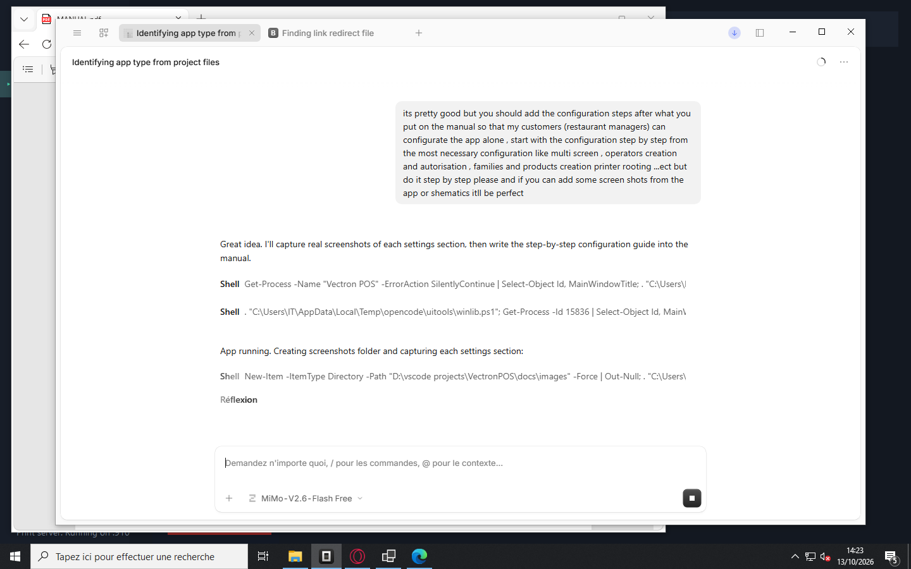

---

## Step 1 — Multi-screen setup (Main PC + Order PCs)

*Do this first if you have more than one terminal.*

Your restaurant has one **Main PC** (hosts the database) and any number of **Order PCs** (take orders, send to kitchen).

### On the Main PC
1. Open **Settings → Network settings**.
2. Select **Main PC (server) — hosts the database**.
3. Press **Save**.
4. Note the computer name shown at the bottom-left of the screen (e.g. `MAIN PC`) and its IP address.

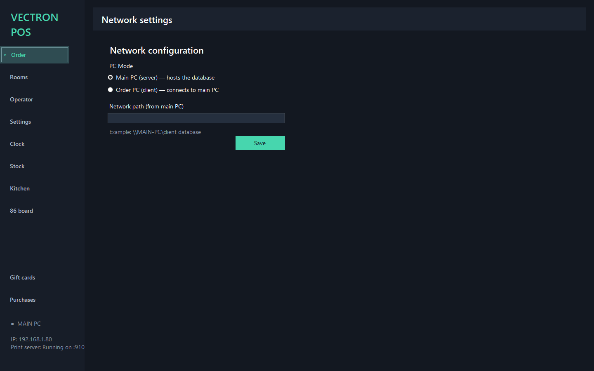

### On each Order PC
1. Install and launch Vectron POS on the second PC.
2. At the network screen (or **Settings → Network settings**), select **Order PC (client) — connects to main PC**.
3. In **Network path**, type the Main PC's shared folder, for example:
   ```
   \\MAIN-PC\client database
   ```
   Replace `MAIN-PC` with your Main PC's actual computer name.
4. Press **Save**. The app restarts and connects to the Main PC.

### Before you start
- Both PCs must be on the **same network** (same router / Wi-Fi).
- Windows file sharing (SMB) must be enabled on the Main PC.
- The status at bottom-left of the Main PC shows `MAIN PC`; Order PCs show `ORDER PC`.

---

## Step 2 — Create your operators (staff logins)

Every person who uses the till gets their own **operator** with a PIN and a role.

1. Open **Settings → Management → Manage operators**.
2. You will see the default operators (Manager, Cashier). Click **New operator**.
3. Fill in:
   - **Operator name** — e.g. `Sara`, `Ahmed`, `Waiter 1`
   - **Password (PIN)** — a 4-digit PIN (e.g. `1111`). Leave empty for no PIN.
   - **Hourly wage** — used for labour-cost reports and payroll export (optional).
4. Tick the **Permissions** this person should have:
   | Permission | Meaning |
   |---|---|
   | **Take payments** | Can process sales and take money |
   | **Discounts** | Can apply discounts / comps |
   | **Refunds** | Can refund past sales |
   | **View sales** | Can open sales reports |
   | **Manage products** | Can edit the product catalog |
   | **Manage rooms** | Can edit rooms / tables / floor plan |
5. Press **Save changes**.
6. Repeat for each staff member.

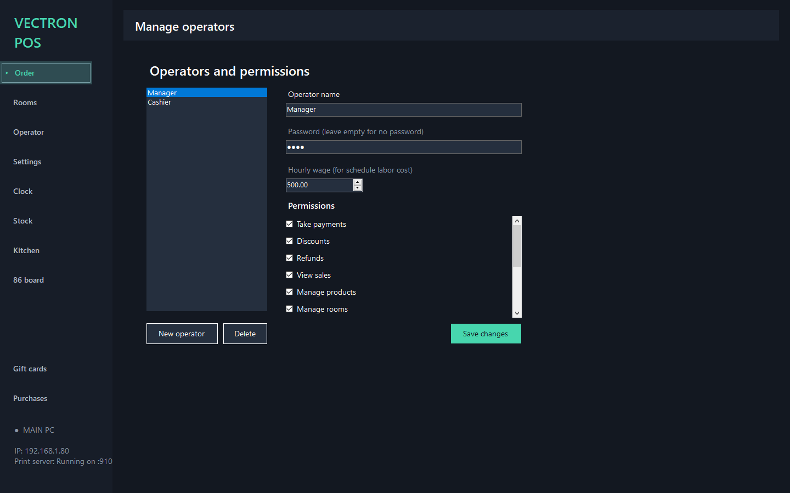

### Recommended setup
| Role | Permissions |
|---|---|
| **Manager** | All boxes ticked |
| **Cashier** | Take payments ✅ · View sales ✅ · rest ❌ |
| **Waiter** | Take payments ✅ · rest ❌ |
| **Kitchen** | No login needed — use Kitchen Display instead |

> **Tip:** give every waiter their own operator so sales and tips are tracked per person.

---

## Step 3 — Set currency and tax (TVA)

1. Open **Settings → Management → Currency and TVA**.
2. **Currency** — pick your currency from the list (EUR €, USD $, MAD, etc.).
3. **TVA rate (%)** — enter your standard tax rate (e.g. `20` for 20 %, `10` for Morocco's 10 %).
4. **Prices already include TVA** — tick this if the menu prices you enter are *tax-inclusive* (normal in restaurants). Leave unticked if prices are *before tax*.
5. Press **Save**.


> All receipts and reports will now show the correct currency and tax.

---

## Step 4 — Create your families (menu categories)

**Families** are the tabs shown at the top of the order screen (Popular, Mains, Drinks…).

1. Open **Settings → Management → Manage families**.
2. You'll see default families (General, Food, Drinks, Desserts). To add your own:
   - Click **New family**.
   - **Family name** — e.g. `Starters`, `Pizzas`, `Hot drinks`, `Shakes`.
   - **Family image** *(optional)* — click **Import** and choose a picture. The tile on the order screen will show it.
   - **Print family to** — choose which printer receives this family's items (e.g. `Kitchen` for food, `Bar` for drinks). This is how kitchen tickets get routed automatically.
3. Press **Save changes**.
4. To assign existing products to this family: select a product in the list on the right, pick the family from the dropdown, press **Save changes**.

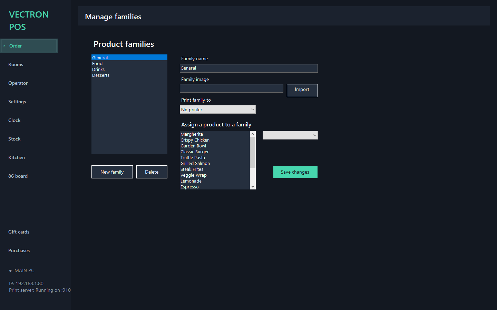

### Example family layout
| Family | Printed to |
|---|---|
| Starters | Kitchen |
| Mains | Kitchen |
| Desserts | Kitchen |
| Hot drinks | Bar |
| Cold drinks | Bar |
| Beers & wine | Bar |

---

## Step 5 — Create your products

1. Open **Settings → Management → Manage products**.
2. Click **New product**.
3. Fill in:
   - **Name** — e.g. `Margherita`, `Chicken Caesar`, `Cappuccino`
   - **Category** — pick the tab where it appears (Popular, Mains, Drinks…)
   - **Price** — sale price (tax rules from Step 3 apply automatically)
   - **Color** *(optional)* — tile colour on the order screen (click to pick)
   - **Image** *(optional)* — click **Import** to add a photo
   - **Barcode** — scan or type the product's barcode (for barcode scanning)
   - **Priced per kg** — tick only for weight-priced items (cheese, meat, candy)
4. Press **Save changes**.
5. Repeat for every product.

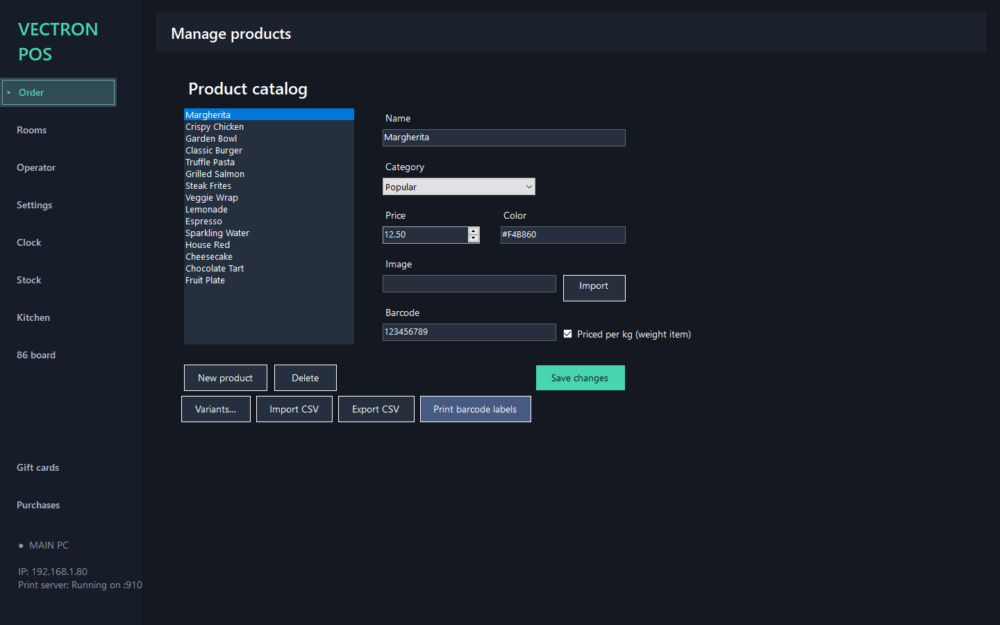

### Shortcuts
- **Import CSV** — bulk-import products from a spreadsheet (Name, Price, Category, Barcode columns).
- **Export CSV** — back up your catalog.
- **Variants…** — add size/color variants (e.g. Small / Medium / Large).
- **Print barcode labels** — print Code-39 shelf labels for your products.

> **Tip:** create families first (Step 4), then products — each product picks its family during creation.

---

## Step 6 — Set up rooms and tables

1. Open **Settings → Management → Room management**.
2. Default rooms (Main dining, Terrace, Private room) are listed. To edit:
   - **Rename** a room by typing in its text box.
   - **Table count** — set how many tables each room has (e.g. Main dining = 20).
3. Click **+ Add room** to create more (e.g. `Bar area`, `Garden`).
4. Press **Save changes**.

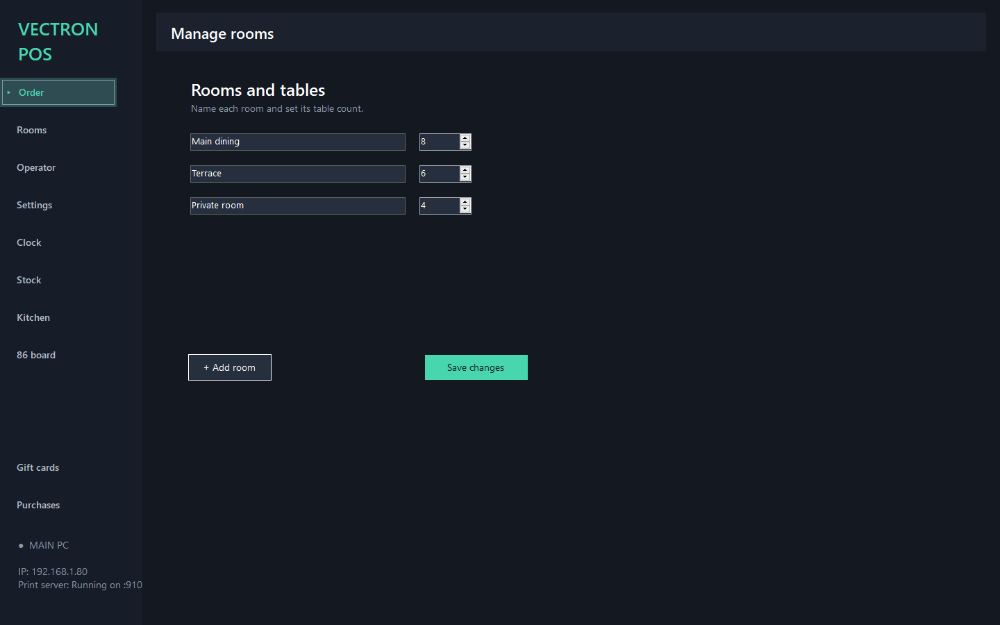

### Arrange tables on the floor plan
1. Go to **Rooms** in the left sidebar.
2. Tap a **room tab** at the top.
3. Each table is a tile — **drag** tiles to match your real layout.
4. Tap a table to open its order; the tile turns 🔴 **Taken** when occupied and returns to ⬪ **Available** when the bill is paid.

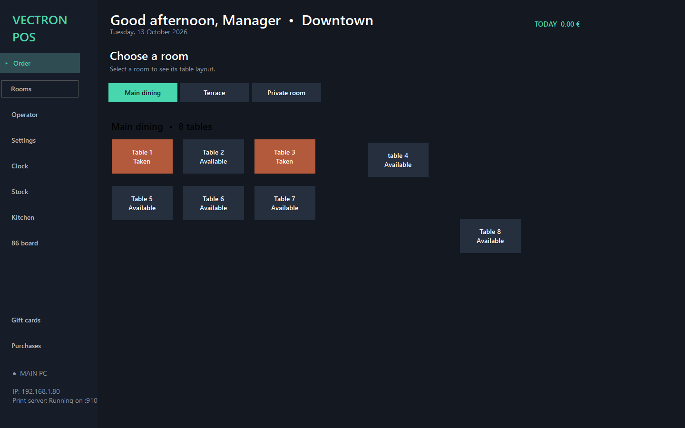

---

## Step 7 — Configure printers (Printer routing)

*This is the most important technical step — tickets must reach the right printer.*

1. Open **Settings → Management → Printer routing**.
2. You'll see default destinations: **Bill**, **Payment**, **Kitchen**, **Refund**, **Cancel**.
3. For each destination:
   - **Destination name** — keep or rename (e.g. `Kitchen 1`, `Bar`, `Receipt`).
   - **Windows printer** — pick the physical printer installed on this PC (e.g. `EPSON TM-T20`, `VLPT2`).
   - **Ticket template → Header** — first line printed (e.g. `KITCHEN ORDER`, `RECEIPT`).
   - **Ticket template → Footer** — last line (e.g. `Thank you!`).
   - **Activate cutter after last line** — tick if the printer has a paper cutter.
4. Click **New destination** to add more (e.g. `Bar printer`, `Grill station`).
5. Press **Save changes**.

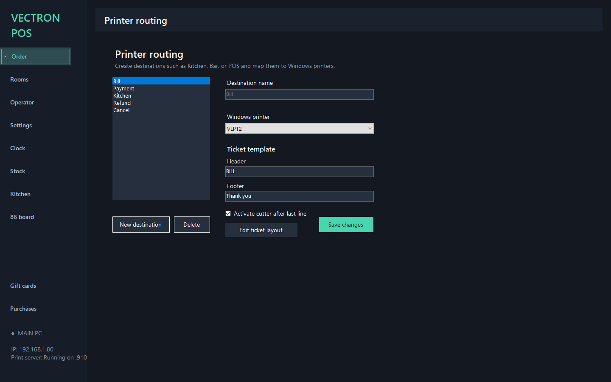

### Typical restaurant routing
| Destination | Printer | Purpose |
|---|---|---|
| **Bill** | Receipt printer (counter) | Customer bill |
| **Payment** | Receipt printer (counter) | Paid receipt |
| **Kitchen** | Kitchen printer | Food orders |
| **Bar** *(new)* | Bar printer | Drink orders |
| **Refund** | Receipt printer | Refund receipts |

### Test your printers
1. Print a Windows test page for each printer (Windows Settings → Printers).
2. In Vectron POS, take a test order and verify the kitchen ticket appears on the kitchen printer.
3. The bottom-left status should show **Print server: Running on :910**.

> **Edit ticket layout** — click this button to fine-tune what's printed (logo, room/table, seat, discount lines…).

---

## Step 8 — Enable payment & pricing features

Open **Settings → Payment Pricing**. Toggle features on/off (🟢 green = ON):

| Feature | What it does |
|---|---|
| **Discounts (% or fixed amount)** | Staff can discount lines / tickets |
| **Voids / comp meals** | Void before payment, comp items for VIPs |
| **Happy hour / timed pricing** | Automatic discounts at set times |
| **Tip management** | Add tips at payment; shown on shift report |
| **Multi-rate (dine-in / takeaway / delivery)** | Different prices per order type |
| **Cash drawer management** | Drawer kick on cash payment + no-sale log |
| **Round cash payments to nearest 5** | Round to 0.05 (handy in cash-heavy markets) |
| **Gift cards / store credit** | Sell & redeem gift cards |
| **Service charge %** | Auto-add service charge on dine-in |
| **Cash discount %** | Cash pays slightly less |
| **Card surcharge %** | Card pays slightly more |
| **Fees / terminal settings** | Per-method fee rules |

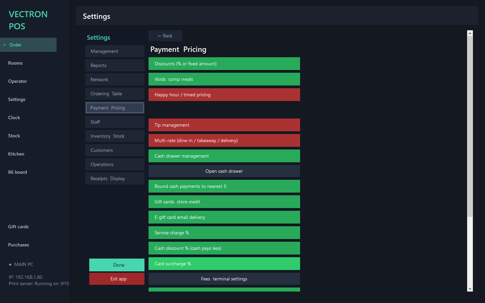

> Toggle OFF anything you don't use — it disappears from the UI and keeps the screen clean for staff.

---

## Step 9 — Staff settings

Open **Settings → Staff**:

| Feature | Recommended | Notes |
|---|---|---|
| **Clock in / out** | 🟢 ON | Staff clock in at login, out at end of shift |
| **Shift reports** | 🟢 ON | Hours + sales per operator |
| **Audit log** | 🟢 ON | Tracks who voided/refunded what |
| **Staff scheduling + tip pooling** | optional | Rota + shared tips |
| **Training mode** | 🔴 OFF for live | Practice without recording sales |
| **Employee discount %** | 🟢 ON | Set the % (e.g. 20) — applies to staff purchases |
| **PIN login** | 🟢 ON | Numeric PIN at startup |
| **Payroll export (CSV)** | 🟢 ON | Hours × wage → accounting |
| **Server performance** | 🟢 ON | Health dashboard |

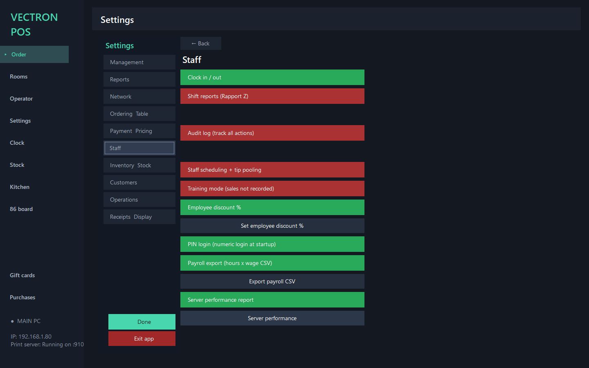

---

## Step 10 — Optional features & final checks

Open each remaining Settings category and switch on what you need:

### Ordering & Table
- Table transfer, split bill, hold/fire courses, park/recall orders, seat ordering.

### Inventory & Stock
- Stock tracking, low-stock alerts, stocktakes, waste tracking, purchase orders, suppliers, barcode labels.

### Customers
- Customer database, loyalty points, gift cards, happy hour.

### Operations
- Delivery orders, multi-branch, refunds, QR self-ordering, kiosk mode, customer display.

### Receipts & Display
- Email/SMS receipts, receipt search & reprint, multi-language (EN / FR / AR).

### Final checklist before opening
- [ ] Operators created with correct PINs and permissions
- [ ] Currency and TVA set correctly
- [ ] Families created and assigned to printers (Kitchen / Bar)
- [ ] All products entered with correct prices
- [ ] Rooms and tables configured; floor plan arranged
- [ ] Printers tested (bill + kitchen at minimum)
- [ ] Payment toggles match how you trade (cash discount? service charge?)
- [ ] Clock-in enabled; training mode OFF
- [ ] Multi-terminal tested (Order PC sees Main PC's data)
- [ ] End-of-day: run a **Z report** to verify totals

---

# Part 3 — Complete Feature List & Configuration Guide

*Every feature Vectron POS offers, what it does, where the switch lives, and how to configure it — detail by detail.*

> **How switches work**
> - Path format: **Settings → category → control**. The categories are the buttons on the left of the Settings screen.
> - 🟢 **Green = ON** · 🔴 **Red = OFF** — toggles **save instantly**, there is no Save button.
> - ⬛ **Dark grey = action button** — opens a dialog or runs a command; most action buttons only appear while their toggle is ON.
> - **Sidebar** buttons (left edge of the order screen) appear/disappear with their feature, and only for operators whose **Permissions** allow them.
> - Everything below is done while logged in as **Manager**.

---

## Master list — all features at a glance

*(ON) = switched on by default at first run; everything else starts OFF. Total: 74 switches + 42 tools.*

### Core — always available (no switch)
| Feature | Where |
|---|---|
| Order taking: category tabs → product tiles → live TOTAL, ± qty, price edit, remove | sidebar **Order** |
| Notes on lines, Note button on open orders | order header **Note** |
| Rooms & tables map (occupied shows running total, free after payment) | sidebar **Rooms** |
| Order types: Dine-in / Takeaway (+ Delivery when enabled; Kiosk mode) | order header |
| Payments: cash with tendered & CHANGE, quick-tender buttons, card | **Take payment** |
| Split tender — several payment methods on one ticket | **Take payment → split** |
| Receipts printing (Bill / Payment destinations) | printer routing |
| Sales details: day/period totals, payment breakdown, by operator/product/family, CSV | Settings → **Sales details** |
| End of day **X / Z** reports + cash-up | Settings → **End day (X / Z)** |
| Multi-terminal: Main PC + Order PCs | Settings → **Network settings** ([Part 2, Step 1](#step-1--multi-screen-setup-main-pc--order-pcs)) |
| Ticket layout editor (font size, bold, underline, alignment per element) | Settings → Printer routing → **Edit ticket layout** |
| Licensing (request code → key → activate) | Settings → **License** |

### Settings → Management (1 switch + 6 tools)
| Feature | Default | Entry |
|---|---|---|
| On-screen touch keyboard (text fields) | ON | toggle |
| Manage operators (names, PINs, wages, permissions) | always | button |
| Manage families (menu tabs + kitchen routing) | always | button |
| Manage products (items, prices, barcodes, CSV, variants, labels) | always | button |
| Room management (rooms, table counts) | always | button |
| Printer routing (bill/kitchen/bar destinations) | always | button |
| Currency and TVA | always | button |

### Settings → Reports (7 switches + 10 tools)
| Feature | Default | Entry |
|---|---|---|
| Live dashboard + hourly graph | OFF | toggle → **Live dashboard** |
| Close-of-day screen (totals by method) | OFF | toggle → **Close-of-day screen** |
| Discount & void frequency report | OFF | toggle → **Discount & void frequency** |
| Occupancy heatmap + dayparts | OFF | toggle → **Occupancy heatmap** |
| Menu engineering matrix | OFF | toggle → **Menu engineering matrix** |
| Accounting export (QuickBooks / Xero) | OFF | toggle → **Accounting export CSV** |
| AI insights (auto analysis) | OFF | toggle → **AI insights** |
| *(tools)* Sales details · End day (X / Z) · **KDS prep-time analytics** (needs KDS late alarm) | always | buttons |

### Settings → Network (3 switches + 4 tools)
| Feature | Default | Entry |
|---|---|---|
| Cloud backup (daily zip to a folder you trust) | OFF | toggle → **Backup & restore** |
| REST API for external systems (POS → ERP / BI) + waiter tablets | OFF | toggle → **API key & webhooks** |
| Cloud sync (share sales with a head-office server) | OFF | toggle → **Cloud sync settings** |
| *(tools)* **Network settings** (Main PC / Order PC) · backup folder · API key & webhooks · cloud sync dialog | always | buttons |

### Settings → Ordering & Table (16 switches + 4 tools)
| Feature | Default | Entry |
|---|---|---|
| Split bill (by seat or item) | ON | toggle → **Split** button on open order |
| Table transfer / merge | ON | toggle → **Transfer / Merge** buttons |
| Product modifiers (extras, size, options) | ON | toggle → **Manage modifier groups** |
| Special instructions per item (kitchen notes) | ON | toggle → **Note** button |
| Course-by-course sending to kitchen | OFF | toggle → **Edit course names** |
| Hold fire — kitchen only gets courses when you press Fire | OFF | toggle (needs courses) |
| Reservations / bookings (floor plan badges) | OFF | toggle → sidebar **Bookings** |
| Kitchen display screen (KDS) | OFF | toggle → sidebar **Kitchen** |
| KDS late alarm (beep & flash past target prep time) | OFF | toggle → target minutes in **KDS prep-time analytics** |
| 86 board (mark products out of stock) | OFF | toggle → sidebar **86 board** |
| Seat-level ordering (items assigned to seats) | OFF | toggle → **SEAT** bar on order header |
| Floor plan editor (drag & drop, rename tables) | OFF | toggle → **Edit floor plan** |
| Park / hold orders & recall later | OFF | toggle → **Park** button |
| Repeat last order & customer usual (2 taps) | OFF | toggle → **Repeat** button |
| Combo meals / deal bundles | OFF | toggle → **Manage combo deals** → **Deals** button |
| Quick-sale / retail mode (counter button) | OFF | toggle → **Quick sale** button |

### Settings → Payment & Pricing (16 switches + 6 tools)
| Feature | Default | Entry |
|---|---|---|
| Discounts (% or fixed amount) | ON | toggle → **Discount** button (+ Discounts permission) |
| Voids & comp meals | ON | toggle → line void/comp actions |
| Happy hour / timed pricing | OFF | toggle → **Manage happy hour rules** |
| Tip management | OFF | toggle → tip entry at payment |
| Multi-rate (dine-in / takeaway / delivery) | OFF | toggle — automatic pricing |
| Cash drawer management | OFF | toggle → sidebar **Drawer**, **Open cash drawer** |
| Round cash payments to nearest 5 | OFF | toggle — automatic at cash tender |
| Gift cards & store credit | OFF | toggle → sidebar **Gift cards** |
| E-gift card email delivery | OFF | toggle (needs SMTP) |
| Service charge % | OFF | toggle → **Fees & terminal settings** |
| Cash discount % (cash pays less) | OFF | toggle → **Fees & terminal settings** |
| Card surcharge % | OFF | toggle → **Fees & terminal settings** |
| Tabs / charge accounts with credit limit | OFF | toggle — at payment |
| Deposits & special orders (layaway) | OFF | toggle → **Special orders / deposits** |
| Offline card payments (queue while terminal down) | OFF | toggle → **Offline payment queue** |
| Virtual terminal (phone orders, invoice links) | OFF | toggle → **Virtual terminal** |

### Settings → Staff (9 switches + 5 tools)
| Feature | Default | Entry |
|---|---|---|
| Clock in / out | OFF | toggle → sidebar **Clock** |
| Shift reports (Rapport Z) | OFF | toggle → **View shift reports** |
| Audit log (track all actions) | OFF | toggle → **View audit log** |
| Staff scheduling + tip pooling | OFF | toggle → sidebar **Schedule** |
| Training mode (sales not recorded) | OFF | toggle — banner appears |
| Employee discount % | OFF | toggle → **Set employee discount %** → Employee button at payment |
| PIN login (numeric login at startup) | OFF | toggle — PIN required for operators that have one |
| Payroll export (hours × wage CSV) | OFF | toggle → **Export payroll CSV** |
| Server performance report | OFF | toggle → **Server performance** |

### Settings → Inventory & Stock (11 switches)
| Feature | Default | Entry |
|---|---|---|
| Ingredient stock / recipe deduction | OFF | toggle → sidebar **Stock** + `recipes.json` |
| Low stock alerts | OFF | toggle — popup when ingredient < min |
| Auto-86 when ingredients hit reorder point | OFF | toggle — needs recipes |
| Stock counts (stocktake) with audit trail | OFF | toggle → **Purchases** → Stocktake tab |
| Waste & expiry tracking | OFF | toggle → **Purchases** → Waste & expiry tab |
| Stock transfers between locations | OFF | toggle → **Purchases** → Transfers tab |
| Weight-priced items (price per kg, scale entry) | OFF | toggle → tick **Priced per kg** on product |
| Product variants (size / color) + CSV import | OFF | toggle → Manage products → **Variants…** |
| Barcode label printing (Code 39) | OFF | toggle → Manage products → **Print barcode labels** |
| Barcode scanning | OFF | toggle → scan field on order screen |
| Purchase orders, suppliers & food cost | OFF | toggle → sidebar **Purchases** |

### Settings → Customers (2 switches + 1 tool)
| Feature | Default | Entry |
|---|---|---|
| Customer database | OFF | toggle → **Manage customers** |
| Loyalty program (points & rewards) | OFF | toggle — points at payment, redeem at payment |

### Settings → Operations (6 switches + 4 tools)
| Feature | Default | Entry |
|---|---|---|
| Delivery orders | OFF | toggle — Delivery order type |
| Multi-branch support | OFF | toggle → **Manage branches & current branch** |
| Refunds (refund ticket, restock, negative sale) | OFF | toggle → find receipt → refund (+ Refunds permission) |
| QR code self-ordering (customer phone scan) | OFF | toggle → **Guest ordering URL & QR code** |
| Kiosk self-order mode (fullscreen, pay at counter) | OFF | toggle → **Launch kiosk** |
| Customer-facing display (2nd screen) | OFF | toggle → **Customer display** |

### Settings → Receipts & Display (3 switches + 2 tools)
| Feature | Default | Entry |
|---|---|---|
| Email / SMS receipts | OFF | toggle → **Email / SMTP settings** |
| Find, reprint & reopen any past receipt | OFF | toggle → **Find past receipts** |
| Multi-language (FR / AR / EN) | OFF | toggle → language buttons on Settings overview |

### Companion systems (configured, not toggled)
| System | Needs | Configure |
|---|---|---|
| **Vectron Waiter** Android tablet app | REST API switch | see [Waiter tablets](#waiter-tablets-configuration) below |
| Guest phones (QR ordering) | QR or Kiosk switch | see [Guest URL & QR](#qr-code-self-ordering) |
| Webhooks / POS→ERP integrations | REST API switch | see [REST API & webhooks](#rest-api--webhooks) |
| Head-office cloud sync / backup vault | Cloud sync switch | see [Cloud sync](#cloud-sync-head-office) |

---

## Configuration guide — step by step

### Management tools

#### Manage operators (staff logins)
- **Entry:** Settings → Management → **Manage operators** (always available to Managers).
1. **New operator** → **Operator name** (e.g. `Sara`), **Password (PIN)** (leave empty for no PIN), **Hourly wage** (for labour reports / payroll).
2. Tick permissions: **Take payments · Discounts · Refunds · View sales · Manage products · Manage rooms** (plus Reservations / Gift cards / Purchasing / Cash drawer where shown).
3. **Save changes** → repeat per person. Edit later by selecting a name in the list (the form shows the selected operator's password).
- **Effect:** operators appear on the login screen; with a password set they must enter it (the tablet app's PIN field appears the same way).
- **Recommended:** Manager = all permissions · Cashier = Take payments + View sales · Waiter = Take payments.

#### Manage families (menu categories + ticket routing)
- **Entry:** Settings → Management → **Manage families**.
1. **New family** → **Family name** (e.g. `Pizzas`).
2. *(optional)* **Family image** → **Import** a picture — the order-screen tile shows it.
3. **Print family to** → pick the printer destination (e.g. `Kitchen` for food, `Bar` for drinks) — **this is how kitchen tickets route automatically**.
4. **Save changes**. To move an existing product: select it in the right-hand list → choose the family → **Save changes**.

#### Manage products (catalog)
- **Entry:** Settings → Management → **Manage products**.
1. **New product** → **Name**, **Category** (family/tab), **Price**.
2. *(optional)* **Color** (tile colour), **Image** → **Import**, **Barcode**, tick **Priced per kg** for scale items.
3. **Save changes** → repeat.
- **Shortcuts (buttons):** **Import CSV** / **Export CSV** (columns: Name, Price, Category, Barcode) · **Variants…** (needs Product variants switch) · **Print barcode labels** (needs Barcode labels switch).

#### Room management
- **Entry:** Settings → Management → **Room management**.
1. Rename rooms in their text boxes; set each room's **Table count**.
2. **+ Add room** for more (e.g. `Garden`) → **Save changes**.
3. Arrange the tiles: sidebar **Rooms** → room tab → **drag** tables; with the Floor plan editor switch ON you can also rename/resize (see [Floor plan editor](#floor-plan-editor)).

#### Printer routing
- **Entry:** Settings → Management → **Printer routing**.
1. Default destinations: **Bill, Payment, Kitchen, Refund, Cancel**. For each: **Windows printer** (the printer installed in Windows), **Header**, **Footer**, **Activate cutter after last line**.
2. **New destination** for more stations (`Bar`, `Grill`) → **Save changes**.
3. **Edit ticket layout** → tune what prints per component: **font size, bold, underline, alignment** (logo, room/table, seat, discount lines…).
- **Verify:** Windows test page → take a test order → bottom-left status shows **Print server: Running on :9100**.

#### Currency and TVA
- **Entry:** Settings → Management → **Currency and TVA**.
1. **Currency** (EUR, USD, MAD…), **TVA rate (%)** (e.g. `20`), tick **Prices already include TVA** if menu prices are tax-inclusive → **Save**.
- **Effect:** receipts, totals and reports switch to this currency/tax immediately.

#### On-screen touch keyboard
- **Switch:** Settings → Management → **On-screen touch keyboard (text fields)** 🟢 ON (default).
- **Effect:** a floating touch keyboard opens whenever you focus a text field — for tablets/till touch screens. Turn OFF on machines with a physical keyboard if it gets in the way.

---

### Reports

#### Live dashboard + hourly graph
- **Switch:** Settings → Reports → **Live dashboard + hourly graph**.
- **Open:** same screen → **Live dashboard** button — real-time KPIs and an hourly sales graph while trading.

#### Close-of-day screen
- **Switch:** Settings → Reports → **Close-of-day screen**.
- **Open:** → **Close-of-day screen** button — totals by payment method for the day (does not close the day; the Z report does).

#### Discount & void frequency
- **Switch:** Settings → Reports → **Discount & void frequency**.
- **Open:** → **Discount & void frequency** button — who discounted/voided what, how often (pairs with the Audit log).

#### Occupancy heatmap + dayparts
- **Switch:** Settings → Reports → **Occupancy heatmap + dayparts**.
- **Open:** → **Occupancy heatmap** button — covers by hour/daypart to staff your busy hours.

#### Menu engineering matrix
- **Switch:** Settings → Reports → **Menu engineering matrix**.
- **Open:** → **Menu engineering matrix** button — stars / plowhorses / puzzles / dogs from quantity × margin.

#### Accounting export (QuickBooks / Xero)
- **Switch:** Settings → Reports → **Accounting export**.
- **Open:** → **Accounting export CSV** — invariant-decimal CSV journal for accounting software.

#### AI insights (auto analysis)
- **Switch:** Settings → Reports → **AI insights**.
- **Open:** → **AI insights** — plain-language summary of the day's patterns.

#### KDS prep-time analytics (+ target prep minutes)
- **Prerequisite:** Ordering → **KDS late alarm** ON.
- **Open:** Settings → Reports → **KDS prep-time analytics**.
- The dialog shows completed tickets with their prep minutes; the **target prep time** box (1–180 minutes, default 15) sets the threshold the KDS uses to beep/flash. Change it → saved immediately (confirmation popup).

---

### Network

#### Network settings (Main PC / Order PCs)
- **Entry:** Settings → Network → **Network settings** (or the first-run network screen).
1. Choose **Main PC (server) — hosts the database** on the machine that holds `client database`.
2. On every other terminal choose **Order PC (client)** and type the shared path: `\\MAIN-PC\client database` → **Save** (the app reconnects to the shared folder).
- **Check:** same LAN, SMB sharing on, bottom-left status shows `MAIN PC` / `ORDER PC`.

#### Cloud backup (offline daily zip)
- **Switch:** Settings → Network → **Cloud backup (daily zip to a folder you trust)**.
1. → **Backup & restore** button.
2. **Backup folder** → **Browse…** (network share, NAS, or sync folder).
3. Tick **Run a backup automatically once a day** → **Save settings**.
4. Buttons: **Backup now** (immediate `vectron-backup-<timestamp>.zip`) · **Restore from backup…** (pick a zip → confirms it OVERWRITES the database → app restarts) · the dialog shows the last backup found in the folder.

#### REST API & webhooks
- **Switch:** Settings → Network → **REST API for external systems (POS → ERP / BI)**.
1. → **API key & webhooks** button.
2. **API key** → click **Generate** (or type your own) — required on every request as `?key=…` / body `key`.
3. *(optional)* **Webhook URL** → every completed sale POSTs JSON like `{ "event": "sale.completed", "total": 12.5, … }` → **Send test** verifies delivery → **Save**.
4. Endpoints listed in the dialog: `/api/sales`, `/api/products`, `/api/orders`, `/api/tablet/bootstrap` (plus tablet login/menu/map/order/line-edit/fire/bill/alerts — see [§16](#16-network-cloud-and-api)).

#### Cloud sync (head office)
- **Switch:** Settings → Network → **Cloud sync (share sales with a head-office server)**.
1. → **Cloud sync settings** button.
2. **Sync server URL** (e.g. `http://hq.example.com:8080`).
3. **Shared key** (leave empty to reuse the API key), **Sync every (minutes)** (1–1440, default 5).
4. **Store ID** (e.g. `RESTO-1` — used for backups/restore; defaults to the PC name).
5. *(optional)* tick **Pull other stores' sales automatically** (off = push only).
6. Buttons: **Save settings** · **Sync now** · **Upload backup now** (daily zip to head office, 14-zip rotation) · **Pull sales history** (restores *this* store's sales) · **Restore from home…** (download latest backup zip → overwrites local → restart).
7. The status block shows Store ID, sales waiting to push, last sync, last backup upload.

#### Waiter tablets (configuration)
*Android tablets run the **Vectron Waiter** app: floor map, orders printed by the Main PC, inline qty steppers, line cancel, fire courses, bill printing, guest alerts, offline queue.*

1. **Main PC:** Settings → Network → switch **REST API** 🟢 ON → **API key & webhooks** → **Generate** key → **Save**.
2. Firewall: allow TCP **8080** on the LAN (the app talks plain `http://<PC-IP>:8080` — cleartext is enabled inside the app).
3. **Tablet:** install `com.vectron.waiter-Signed.apk` → open the app → enter **Main PC address** = `http://<PC-IP>` (the app appends `:8080`) and the **API key** → **Connect**.
4. Pick your **name** → enter your **PIN** if the operator has a password (operators without one sign in without PIN) → **Sign in**.
5. Daily use: tap a **table** → tap **products** → **Send to kitchen** (prints on the Main PC) → use **−/+** to change a sent quantity, **✕** to cancel a line (no dialogs), **Fire** for the next course, **Bill** to print the bill. The bell shows *call waiter* / *kitchen ready* alerts.
6. **Offline safety:** lost Wi-Fi → orders queue on the device and retry; server `pending_id` deduplication guarantees a retry never prints twice.
7. **System notifications:** while signed in, the app keeps a silent background service running (shown as the low-priority *Vectron Waiter · connected* notification — Android requires it, leave it be). Every **call waiter** and **order ready** alert also raises a normal phone/tablet notification: heads-up banner, default notification sound, vibration, screen lights up, and it stays in the notification bar. Tap it → the app opens on the **Notifications** page; **Done** / **Clear all** there also removes it from the bar. First sign-in asks twice: **Allow notifications** (tap *Allow*) and **Keep alerts alive** → battery settings (tap *Open settings* → allow) so alerts are never delayed by battery saving. Alerts restart automatically after a reboot or app update (boot receiver + a persisted 60-second watchdog job, plus a re-check every time the app is opened). On Chinese-brand phones/tablets and emulators (Xiaomi, Oppo/Vivo, LDPlayer…) the ROM may additionally kill background apps: add Vectron Waiter to the **auto-start / background-whitelist** (Settings → Apps → Vectron Waiter → *Auto-start* / *Battery* → *No restrictions*) if notifications ever stop while the app is closed.

---

### Ordering & Table Service

#### Split bill (by seat or item)
- **Switch:** Settings → Ordering & Table → **Split bill (by seat or item)** 🟢 ON (default).
- **Use:** open an occupied table → **Split** button → split **by seat**, **by item**, or a **custom amount** → take each part's payment separately.

#### Table transfer / merge
- **Switch:** Settings → Ordering & Table → **Table transfer / merge** 🟢 ON (default).
- **Use:** on an open order, **Transfer** moves it to another table; **Merge** combines two tables' orders (Manager).

#### Product modifiers (extras, size, options)
- **Switch:** Settings → Ordering & Table → **Product modifiers** 🟢 ON (default).
1. → **Manage modifier groups** button.
2. Create a group (e.g. `Size`, `Extras`) → add options with their **prices** (e.g. `Large +2.00`) → save.
- **Use:** tapping a product offers the group's options; chosen options add their price to the line and print on tickets and the KDS. Tablets show the same sheet.

#### Special instructions per item (item notes)
- **Switch:** Settings → Ordering & Table → **Special instructions per item** 🟢 ON (default).
- **Use:** the **Note** button on an open order (or the line's note action) attaches a free-text kitchen note — it prints on the ticket and shows on the KDS as `• note`.

#### Course-by-course sending to kitchen
- **Switch:** Settings → Ordering & Table → **Course-by-course sending to kitchen**.
1. → **Edit course names (Course 1 = …)** → rename courses (e.g. `Starters`, `Mains`, `Dessert`).
2. On each order line click its **course button** (shows `C`/the course name) to assign the line to a course.
3. The order header shows **Fire \<next course\>** — press it to print/send only that course; **Delay fire** schedules it after N minutes.

#### Hold fire — kitchen gets courses only when you fire
- **Switch:** Settings → Ordering & Table → **Hold fire** (with courses ON).
- **Effect:** items stay held on the order until you press **Fire** — nothing reaches the kitchen early. Fire the next course manually (or via delay fire / tablet **Fire**).

#### Reservations / bookings
- **Switch:** Settings → Ordering & Table → **Reservations**.
- **Permission:** operator needs **Reservations**.
- **Use:** sidebar **Bookings** appears → add a booking: **name, phone, party size, date/time, room, table** → the table tile shows a `booked` badge on its day; change status (seated / cancelled) from the list.

#### Kitchen display screen (KDS)
- **Switch:** Settings → Ordering & Table → **Kitchen display screen (KDS)**.
- **Use:** sidebar **Kitchen** appears — a live ticket queue (second screen/PC): elapsed timer per ticket (green <10 min, orange <20, red after), tap a ticket to bump/complete; only fired courses are visible when courses are on.

#### KDS late alarm
- **Switch:** Settings → Ordering & Table → **KDS late alarm (beep & flash past target prep time)**.
- **Configure:** Settings → Reports → **KDS prep-time analytics** → set **target prep time** (1–180 min, default 15).
- **Effect:** tickets older than the target beep (`950 Hz`) and flash red until bumped.

#### 86 board (out of stock)
- **Switch:** Settings → Ordering & Table → **86 board**.
- **Use:** sidebar **86 board** → every product grouped by category → **86 it** turns it struck-through and un-orderable (ordering attempts warn *out of stock (86'd)*) → **Restore** brings it back.
- Pairs with **Auto-86** (Inventory) which marks items automatically from ingredient levels.

#### Seat-level ordering
- **Switch:** Settings → Ordering & Table → **Seat-level ordering**.
- **Effect:** a **SEAT 1/2/3…** bar appears on the order header; new lines attach to the selected seat, tickets and KDS show `[S1]`, and split-by-seat payment uses these seats.

#### Floor plan editor
- **Switch:** Settings → Ordering & Table → **Floor plan editor** (needs **Manage rooms** permission).
- **Open:** → **Edit floor plan (opens Rooms view)** button, or sidebar **Rooms**.
- **Use:** drag tables to match the room, rename (double-click), resize, set capacity — layout stored per room.

#### Park / hold orders & recall
- **Switch:** Settings → Ordering & Table → **Park / hold orders & recall later**.
- **Use:** **Park** button (with items or an open order) clears the screen and files the order; recall it later from the parked-orders list and continue.

#### Repeat last order (2 taps)
- **Switch:** Settings → Ordering & Table → **Repeat last order & customer usual**.
- **Use:** **Repeat** button duplicates the last ticket's lines into a new order — takeaway regulars.

#### Combo meals / deal bundles
- **Switch:** Settings → Ordering & Table → **Combo meals / deal bundles**.
1. → **Manage combo deals** → **New**: **name**, **price**, then pick a product + qty → **+** to add components → **Save**.
2. On the order screen the **Deals** button appears → tapping it adds all component lines (marked `in <deal>`) at the bundle price.

#### Quick-sale / retail mode
- **Switch:** Settings → Ordering & Table → **Quick-sale / retail mode (counter button)**.
- **Effect:** a **Quick sale** button and the barcode scan field appear on the order screen — scan or tap, take payment, done (counter/retail flow).

---

### Payment & Pricing

#### Discounts (% or fixed)
- **Switch:** Settings → Payment & Pricing → **Discounts** 🟢 ON (default). Permission: **Discounts**.
- **Use:** **Discount** button on the order header → percent or fixed amount → applies per line or to the whole ticket; the button shows the active `Discount 10%`.
- Employee discount (separate) is the orange **Employee x%** button at payment — see [Employee discount %](#employee-discount-).

#### Voids & comp meals
- **Switch:** Settings → Payment & Pricing → **Voids & comp meals** 🟢 ON (default).
- **Use:** void a line before payment; comp marks it free (0.00). Both are audited when the Audit log is ON and appear in the discount & void report.

#### Happy hour / timed pricing
- **Switch:** Settings → Payment & Pricing → **Happy hour / timed pricing**.
1. → **Manage happy hour rules** → **Add rule**.
2. Fill: **Name**, **Start** time, **End** time, **Discount %** (1–100).
3. Tick the weekday abbreviations (Mo Tu We Th Fr Sa Su) → **Save**.
- **Effect:** prices drop automatically inside the window (tablet bootstrap reports `happy_hour`); rules are edited/deleted from the same list.

#### Tip management
- **Switch:** Settings → Payment & Pricing → **Tip management**.
- **Effect:** a tip field appears at payment, added to the total; tips land on the shift report and payroll export.

#### Multi-rate (dine-in / takeaway / delivery)
- **Switch:** Settings → Payment & Pricing → **Multi-rate**.
- **Effect:** automatic pricing per order type at payment — **Takeaway ×0.9 (−10 %)**, **Delivery ×0.85 (−15 %)**, dine-in unchanged.

#### Cash drawer management
- **Switch:** Settings → Payment & Pricing → **Cash drawer management**. Permission: **Cash drawer**.
- **Effect:** the drawer kicks on cash payment; **No-sale** opens are logged.
- **Manual open:** sidebar **Drawer**, or Settings → Payment & Pricing → **Open cash drawer**.

#### Round cash payments to nearest 5
- **Switch:** Settings → Payment & Pricing → **Round cash payments to nearest 5**.
- **Effect:** cash totals round to the nearest 0.05; the receipt shows a **ROUNDING** line.

#### Gift cards & store credit
- **Switch:** Settings → Payment & Pricing → **Gift cards & store credit**. Permission: **Gift cards**.
- **Use:** sidebar **Gift cards** → sell/activate cards, check balances; at payment choose the gift-card tender — balance applies to the due total; balances live in the shared database.

#### E-gift card email delivery
- **Switch:** Settings → Payment & Pricing → **E-gift card email delivery** (configure SMTP first — [Email / SMTP](#email--sms-receipts)).
- **Effect:** the gift card is emailed to the customer at sale time.

#### Service charge % / Cash discount % / Card surcharge %
- **Switches:** Settings → Payment & Pricing → each of the three toggles.
1. With any of them ON (or Offline payments ON) the **Fees & terminal settings** button appears → click it.
2. Set **Service charge %** (adds to total), **Cash discount %** (subtracts when paid cash), **Card surcharge %** (adds when paid card) — each 0–50, one decimal.
3. **Save** — fees calculate at payment and print as their own receipt lines (saved actions are audit-logged when Audit log is ON).

#### Tabs / charge accounts
- **Switch:** Settings → Payment & Pricing → **Tabs / charge accounts with credit limit**.
- **Use:** open a customer tab, keep charging items over time, settle later; the customer's credit balance is enforced when paying by charge.

#### Deposits & special orders (layaway)
- **Switch:** Settings → Payment & Pricing → **Deposits & special orders (layaway)**.
1. → **Special orders / deposits** button — take a deposit now against a future order; collect goods and settle the balance later from the same list.

#### Offline card payments
- **Switch:** Settings → Payment & Pricing → **Offline card payments**.
1. → **Offline payment queue** button — queued card payments while the terminal/network is down.
2. In **Fees & terminal settings** tick **Card terminal offline (queue card payments)** while offline; sales record immediately and settle when you untick.

#### Virtual terminal (phone orders)
- **Switch:** Settings → Payment & Pricing → **Virtual terminal**.
1. → **Virtual terminal** button — take a phone order and email an invoice/payment link instead of tapping a card.

---

### Staff

#### Clock in / out
- **Switch:** Settings → Staff → **Clock in / out**.
- **Effect:** sidebar **Clock** button appears; staff clock in at login and out at end of shift; hours feed shift reports and payroll.

#### Shift reports
- **Switch:** Settings → Staff → **Shift reports (Rapport Z)**.
- **Open:** → **View shift reports** — hours worked, sales per operator, tips, discounts given.

#### Audit log
- **Switch:** Settings → Staff → **Audit log (track all actions)**.
- **Open:** → **View audit log** — who voided, refunded, discounted, changed fees/courses, logged into tablets…
- Recommended ON for live venues; the discount & void frequency report analyses it.

#### Staff scheduling + tip pooling
- **Switch:** Settings → Staff → **Staff scheduling + tip pooling**. Permission: **Manage operators**.
- **Use:** sidebar **Schedule** → add shifts: **operator, date, start time, end time** — weekly rota view; tip pooling is handled with the shift totals.

#### Training mode
- **Switch:** Settings → Staff → **Training mode (sales not recorded)**.
- **Effect:** a warning banner appears; sales are **not recorded** (not in reports, not in stock). Keep OFF for live trading.

#### Employee discount %
- **Switch:** Settings → Staff → **Employee discount %**.
1. → **Set employee discount %** → choose 0–100 (default 10, step 5) → OK.
- **Use:** at payment the orange **Employee x%** button applies it to staff purchases.

#### PIN login
- **Switch:** Settings → Staff → **PIN login (numeric login at startup)**.
- **Effect:** login asks for a **numeric PIN** for operators that have a password set (label switches PIN vs password). Operators without a password still sign in with just their name — set passwords in Manage operators to require them (also enables the PIN field on waiter tablets).

#### Payroll export (CSV)
- **Switch:** Settings → Staff → **Payroll export**.
- **Open:** → **Export payroll CSV** — hours × hourly wage per operator, invariant decimals, ready for accounting.

#### Server performance
- **Switch:** Settings → Staff → **Server performance report**.
- **Open:** → **Server performance** — per-terminal health ranking (uptime/sales); use it when the app feels slow.

---

### Inventory & Stock

#### Ingredient stock / recipe deduction
- **Switch:** Settings → Inventory & Stock → **Ingredient stock / recipe deduction**.
1. Sidebar **Stock** → **Add** ingredient: **Name**, **Unit** (e.g. `kg`, `L`), **Stock** quantity → OK. (List columns: stock, min, cost, expiry; expired rows show red, expiring ≤7 days orange.)
2. Define recipes in the shared database file `client database/recipes.json` — per product, the ingredient quantities consumed:
   ```json
   {
     "Margherita": [
       { "Ingredient": "Flour", "Quantity": 0.2 },
       { "Ingredient": "Mozzarella", "Quantity": 0.12 }
     ]
   }
   ```
3. On each completed payment the recipe quantities are deducted from ingredient stock (training sales are skipped).

#### Low stock alerts
- **Switch:** Settings → Inventory & Stock → **Low stock alerts** (stock + recipes needed).
- **Effect:** when a sale drops an ingredient below its **Min Stock**, a popup lists every affected ingredient with remaining qty and the product that uses it.

#### Auto-86 when ingredients hit reorder point
- **Switch:** Settings → Inventory & Stock → **Auto-86** (recipes needed).
- **Effect:** affected products are marked 86 automatically → greyed out on the menu and listed on the 86 board; **Restore** on the 86 board clears the auto mark.

#### Stock counts (stocktake)
- **Switch:** Settings → Inventory & Stock → **Stock counts (stocktake) with audit trail**.
- **Where:** sidebar **Purchases** → **Stocktake** tab (the Purchasing switch + permission are required to open Purchases at all).
- **Use:** **count** physical quantities per ingredient (optional **note**) → only differences are saved as a stocktake record — system qty, counted qty, who, when; history lists past stocktakes; audit-logged when Audit log is ON.

#### Waste & expiry tracking
- **Switch:** Settings → Inventory & Stock → **Waste & expiry tracking**.
- **Where:** sidebar **Purchases** → **Waste & expiry** tab.
- **Use:** **Log waste** → ingredient, qty (cannot exceed stock), reason (defaults to `Waste`) — stock drops and the entry is logged with who/when; **Set expiry** marks ingredient expiry dates (Stock list colours expired red, ≤7 days orange).

#### Stock transfers between locations
- **Switch:** Settings → Inventory & Stock → **Stock transfers** (locations also need **Multi-branch**).
- **Where:** sidebar **Purchases** → **Transfers** tab.
- **Use:** **New transfer** → From ≠ To, ingredient, qty (≤ available at source) → saves a numbered transfer with who/when; stock moves from source location to destination.

#### Weight-priced items
- **Switch:** Settings → Inventory & Stock → **Weight-priced items**.
1. Manage products → tick **Priced per kg** for the item.
- **Use:** tapping it at the till asks for **kg** → price = kg × unit price; the line note records `x kg @ price/kg`.

#### Product variants (size / color)
- **Switch:** Settings → Inventory & Stock → **Product variants**.
1. Manage products → **Variants…** → add variants with prices (Small/Medium/Large) or import CSV.
- **Use:** tapping the product offers the variant; the chosen variant's price is used and shown on tickets/reports.

#### Barcode label printing (Code 39)
- **Switch:** Settings → Inventory & Stock → **Barcode label printing**.
- **Use:** Manage products → **Print barcode labels** → prints Code-39 shelf labels from the catalog barcodes.

#### Barcode scanning
- **Switch:** Settings → Inventory & Stock → **Barcode scanning**.
- **Effect:** the scan field appears on the order screen — scan (or type) a barcode → the product is added instantly. (Quick-sale mode shows the field too.)

#### Purchase orders, suppliers & food cost
- **Switch:** Settings → Inventory & Stock → **Purchase orders, suppliers & food cost**. Permission: **Purchasing**.
- **Use:** sidebar **Purchases** → tabs **Purchase orders** · **Suppliers** · **Profit (food cost)** plus, when their switches are ON, **Stocktake** · **Waste & expiry** · **Transfers**:
  1. **Suppliers**: add/edit vendors.
  2. Create a **purchase order** (supplier, ingredient, qty, cost) → **receive** it — ingredient stock increases; cancel or email the PO as PDF.
  3. **Profit** tab: revenue, food cost and margin per product for today / 7 / 30 days / all time.
  4. A banner warns **ingredients at/below reorder point** with a **Reorder low** shortcut.

---

### Customers

#### Customer database
- **Switch:** Settings → Customers → **Customer database**.
1. → **Manage customers** → add records (**name, phone, email, notes**).
- **Use:** attach a customer to a ticket → purchase history, loyalty, balance (used by tabs/charge accounts and store credit).

#### Loyalty program
- **Switch:** Settings → Customers → **Loyalty program (points & rewards)** (customer database used).
- **Effect:** customers earn points per purchase; points redeem as a discount at payment (`redeem` field in the tender screen).

---

### Operations

#### Delivery orders
- **Switch:** Settings → Operations → **Delivery orders**.
- **Effect:** the **Delivery** order type joins the order-type selector; delivery tickets/reports are distinguishable by type (and priced with the multi-rate discount if enabled).

#### Multi-branch support
- **Switch:** Settings → Operations → **Multi-branch support**.
1. → **Manage branches & current branch** → type a branch name → **Add** (repeat) → **Remove selected** to delete.
2. Choose the **Current branch for this register** → **Save** — a badge appears next to the operator name; every sale is stamped with this branch.

#### Refunds
- **Switch:** Settings → Operations → **Refunds**. Permission: **Refunds**.
- **Use:** find the past sale (**Find past receipts** or sales list) → select items → refund to the original method → a **refund ticket** prints to the Refund destination, stock is restocked, and a negative sale is recorded.

#### QR code self-ordering
- **Switch:** Settings → Operations → **QR code self-ordering (customer phone scan)** (Kiosk switch also enables the URL dialog).
1. → **Guest ordering URL & QR code**:
   - **Built-in local URL**: `http://<PC-IP>:8080` — guests on your Wi-Fi open it directly.
   - *(optional)* **Public URL override** for a tunnel/domain → **Save** (the order-screen banner and QR labels then use it).
   - **Copy URL** / QR preview for sharing.
2. Open the **QR orders** screen (order-screen banner) → **Table QR labels** → pick tables → **Print** — each label's QR opens the menu pre-attributed to that table.
3. Guests browse, order, **call waiter** and check order status from the phone page; guest orders appear on the main screen with a source badge.

#### Kiosk self-order mode
- **Switch:** Settings → Operations → **Kiosk self-order mode**.
1. → **Launch kiosk** — fullscreen self-order, pay at counter.
2. Share the same **Guest ordering URL** if customers should order from their own phones.

#### Customer-facing display
- **Switch:** Settings → Operations → **Customer-facing display (2nd screen)**.
1. → **Customer display** — opens the guest-facing window (second monitor) showing the running total and thank-you message.

---

### Receipts & Display

#### Email / SMS receipts
- **Switch:** Settings → Receipts & Display → **Email / SMS receipts**.
1. → **Email / SMTP settings** → fill **SMTP host, Port, Username, Password, From address**, tick **TLS** → **Save**.
- **Use:** at payment the receipt can be sent by email (also required for e-gift email delivery).

#### Find, reprint & reopen any past receipt
- **Switch:** Settings → Receipts & Display → **Find, reprint & reopen any past receipt**.
1. → **Find past receipts** → pick a **date** → select a ticket → reprint it, reopen it, or start a refund (with the Refunds switch/permission).

#### Multi-language (FR / AR / EN)
- **Switch:** Settings → Receipts & Display → **Multi-language (FR / AR / EN)**.
- **Use:** language buttons (**English / Français / العربية**) appear at the top of Settings — click one → the app saves and **restarts** to apply.
- Currency/date format follow the language (en-GB / fr-FR / ar-MA); Arabic flips the whole layout **RTL**. Product/room/table/payment names are your data and never translate.

---

### Companion systems

#### Vectron Waiter tablets
Covered step-by-step under [Waiter tablets (configuration)](#waiter-tablets-configuration) above; endpoints table in [§16](#16-network-cloud-and-api).

#### Kiosk / guest phones / webhooks / cloud
See [QR code self-ordering](#qr-code-self-ordering), [Kiosk self-order mode](#kiosk-self-order-mode), [REST API & webhooks](#rest-api--webhooks) and [Cloud sync](#cloud-sync-head-office) above.

---

## Feature checklist — before you go live

- [ ] Currency + TVA set; prices tax-inclusive flag correct
- [ ] Operators with PINs & minimal permissions (Part 2, Step 2)
- [ ] Families routed to Kitchen / Bar printers; printers tested
- [ ] Rooms/tables arranged; floor plan matches reality
- [ ] Payment switches match your trade (service charge? cash discount? rounding?)
- [ ] PIN login ON; training mode OFF; audit log ON
- [ ] Language chosen (EN / FR / AR)
- [ ] Waiter tablets: REST API ON + strong key; tablets connected and tested
- [ ] Cloud backup folder set + **Backup now** tested once
- [ ] Optional features you need turned ON (loyalty, stock, QR, KDS, happy hour…)
- [ ] End of day: run a **Z report** and cash-up once as a rehearsal

---

## Licensing

Each PC (Main PC + each Order PC) requires its own license. Licenses are issued by your supplier and bound to one machine.

### How to activate
1. Open **Settings → License**.
2. Click **Copy** next to your **Request code** (e.g. `REQ-A396-5417-972A-66C2`).
3. Send this request code to your supplier.
4. Your supplier issues a license key (e.g. `VECT-AGIVW2YR-2Q32HFSU-...`) valid for 1 year, 2 years, etc.
5. Paste the key into the **License key** field and click **Activate**.

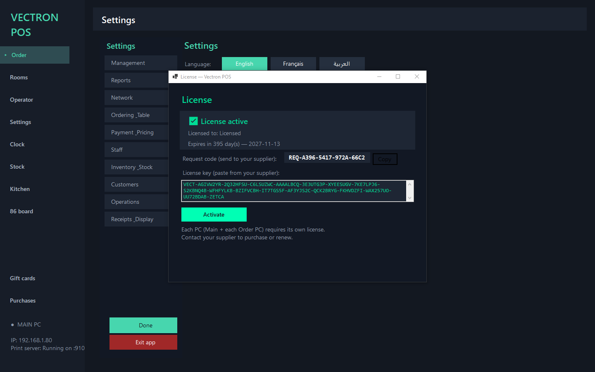

### License status
| Status | Meaning |
|---|---|
| ✅ **License active** | Valid — shows expiry date and days remaining |
| ⚠️ **Grace period** | Expired but still working — warning banner shown, renew soon |
| 🔴 **Expired** | Sales blocked — enter a new license key |
| 🔴 **Invalid** | Key doesn't match this PC — contact supplier |

### Important
- A license key works on **one PC only** — it's bound to that machine's hardware.
- If you replace a PC, contact your supplier for a new key.
- **3-PC restaurant** = 3 licenses (1 per terminal).
- Renewal: your supplier issues a new key with a new expiry date.

---

## Quick reference — Settings map

```
Settings
├── Management
│   ├── Manage operators      ← staff logins + permissions
│   ├── Manage families       ← menu categories + kitchen routing
│   ├── Manage products       ← items, prices, barcodes
│   ├── Room management       ← rooms + table counts
│   ├── Printer routing       ← bill / kitchen / bar printers
│   └── Currency and TVA      ← currency + tax rate
├── Reports                   ← all sales / performance reports
├── Network                   ← Main PC / Order PC, cloud sync
├── Ordering Table            ← split, transfer, courses, floor plan
├── Payment Pricing           ← discounts, tips, fees, rounding
├── Staff                     ← clock, shifts, payroll, training
├── Inventory Stock           ← stock, PO, suppliers, waste
├── Customers                 ← database, loyalty, gift cards, happy hour
├── Operations                ← branches, refunds, QR, kiosk, display
└── Receipts Display          ← email, receipt search, language
```

---

*Vectron POS — built for hospitality: fast floor service, honest reporting, three languages.*
