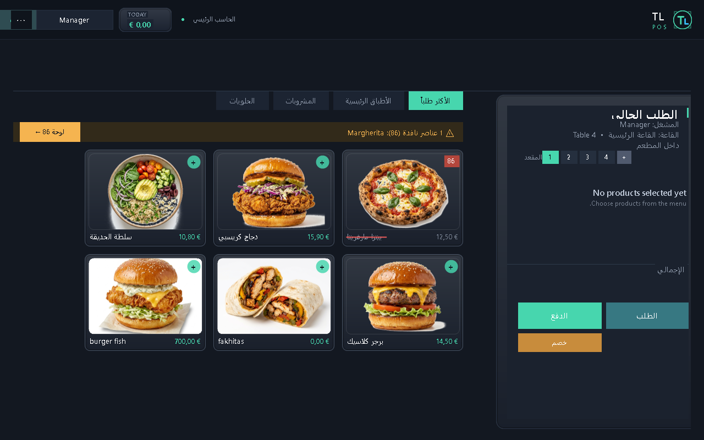
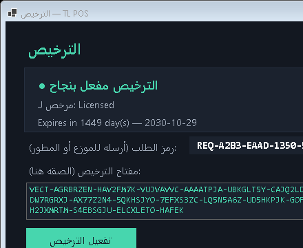
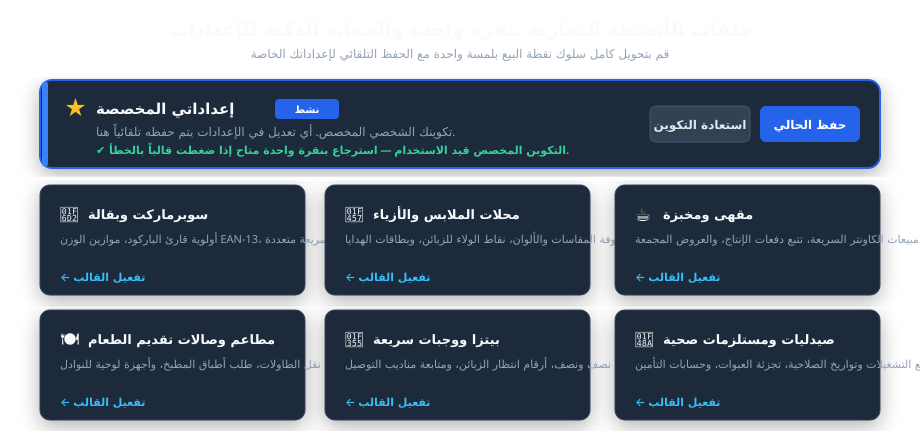
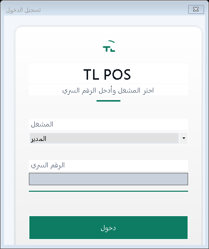
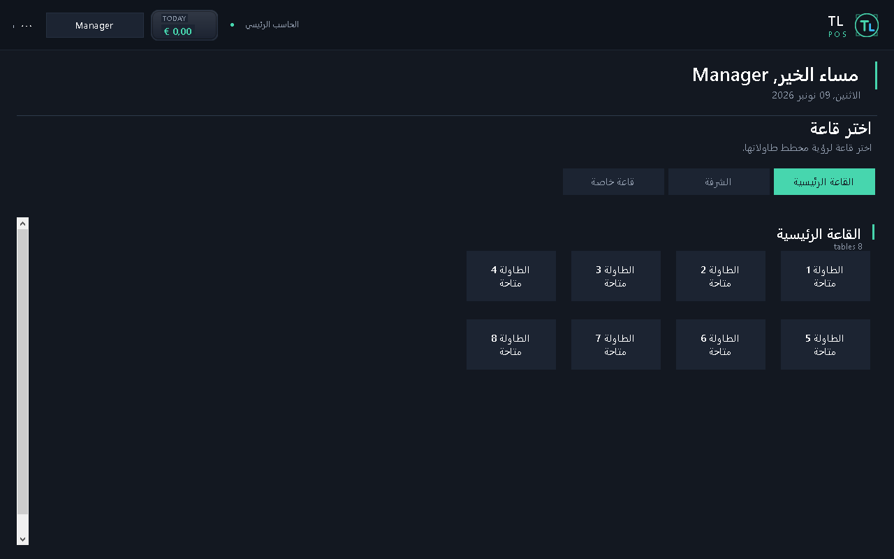
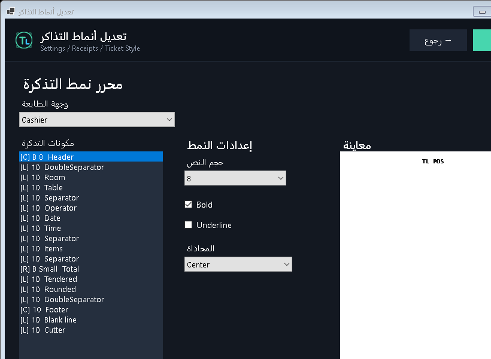
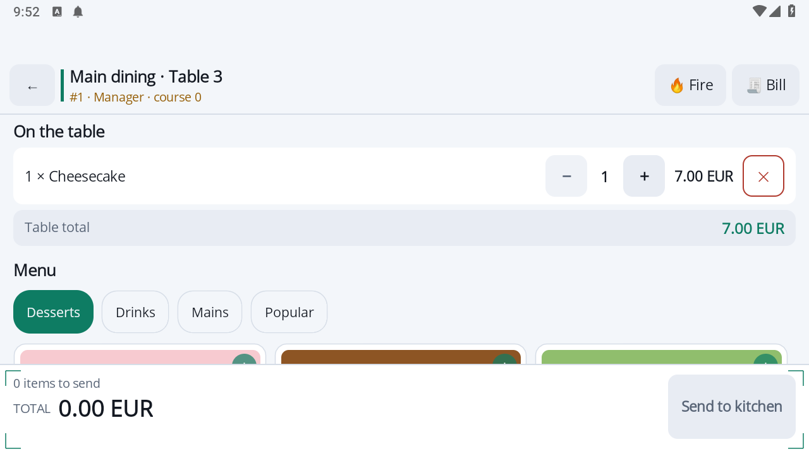
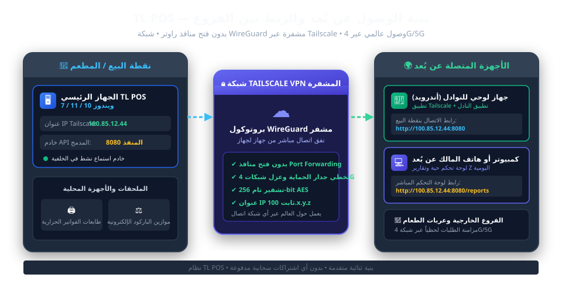

# نظام TL POS — دليل المستخدم والمسؤول الشامل

**المطور والمصمم :** لونيس تينوش (TL)  
**إصدار النظام :** TL POS v2.6 Pro (إصدار الشبكات متعدد الأجهزة)  
**الأنظمة المدعومة :** ويندوز 10، ويندوز 11، ويندوز 7 SP1 / POSReady، وأندرويد 8+  

---

## فهرس المحتويات
- [01. نظرة عامة على النظام والبنية التقنية](#01-نظرة-عامة-على-النظام-والبنية-التقنية)
- [02. التثبيت ومتطلبات التشغيل](#02-التثبيت-ومتطلبات-التشغيل)
- [03. تفعيل الترخيص المشفر (ECDSA)](#03-تفعيل-الترخيص-المشفر-ecdsa)
- [04. ملفات الأنشطة التجارية والحماية الذكية](#04-ملفات-الأنشطة-التجارية-والحماية-الذكية)
- [05. العمليات اليومية: الكاشير، الطاولات والمبيعات](#05-العمليات-اليومية-الكاشير-الطاولات-والمبيعات)
- [06. العتاد والأجهزة: الطابعات، الموازين والفواتير](#06-العتاد-والأجهزة-الطابعات-الموازين-والفواتير)
- [07. تكامل أجهزة النادل اللوحية (تطبيق TL للنوادل)](#07-تكامل-أجهزة-النادل-اللوحية-تطبيق-tl-للنوادل)
- [08. الربط عن بُعد وإدارة الفروع عبر Tailscale VPN](#08-الربط-عن-بُعد-وإدارة-الفروع-عبر-tailscale-vpn)
- [09. إدارة المخزون، الوصفات وتتبع المكونات](#09-إدارة-المخزون-الوصفات-وتتبع-المكونات)
- [10. النسخ الاحتياطي، الصيانة ودليل معالجة الأعطال](#10-النسخ-الاحتياطي-الصيانة-ودليل-معالجة-الأعطال)

---

## 01. نظرة عامة على النظام والبنية التقنية

**TL POS** هو نظام نقاط بيع وإدارة مطاعم ومتاجر عالي الأداء من تصميم وتطوير **لونيس تينوش (TL)**.
صُمم النظام ليوفر أقصى درجات السرعة والموثوقية بدون أطر عمل ثقيلة تستهلك موارد الأجهزة.

### التوافق المزدوج مع أنظمة التشغيل (Dual-Target)
- **TL POS ويندوز 10/11 (`net10.0-windows`) :** إصدار 64 بت فائق السرعة (~45 ميجابايت RAM) لشاشات اللمس الحديثة.
- **TL POS ويندوز 7 (`net48`) :** إصدار مخصص ومضغوط (~25 ميجابايت RAM) متوافق تماماً مع Windows 7 SP1 و POSReady 7.
- **تطبيق النادل أندرويد :** تطبيق سريع بتقنية .NET MAUI لخدمة الطاولات في الصالات والشرفات.

### الألوان والأداء الرسومي
- **النمط الفاتح والنمط الداكن :** راحة بصرية وتكيف كامل مع إضاءة المحل أو المطعم.
- **مستوى الأداء العالي (High Tier) :** مؤثرات ناعمة وانتقالات بصرية بسرعة 60 إطاراً في الثانية.
- **مستوى الأداء الخفيف (Lite Tier) :** واجهة مسطحة تماماً بدون أي استهلاك للمعالج.

---

## 02. التثبيت ومتطلبات التشغيل

### المواصفات الموصى بها
- **المعالج :** Intel Core i3 / i5 أو AMD Ryzen (ويعمل بسلاسة على Celeron / Core 2 Duo).
- **الذاكرة (RAM) :** 2 جيجابايت كحد أدنى، 4 جيجابايت مفضلة.
- **التخزين :** 200 ميجابايت مساحة فارغة (يفضل أقراص SSD).
- **الشاشة :** دقة 1024x768 أو 1920x1080 لمسية.

### خطوات التثبيت على ويندوز
1. انقل مجلد البرنامج إلى القرص (`C:\TL POS`).
2. افتح `publish-win10-x64\TL POS.exe` (لويندوز 10 و 11) أو `publish-win7\TL POS.exe` (لويندوز 7).
3. البرنامج محمول ولا يحتاج لأي تثبيت لقواعد بيانات SQL Server أو MySQL خارجية.

---

## 03. تفعيل الترخيص المشفر (ECDSA)

يعتمد نظام TL POS على تشفير المنحنيات الإهليلجية (ECDSA P-256 / SHA-256):
1. عند التشغيل لأول مرة، تظهر نافذة التفعيل وتعرض **معرّف الجهاز (Machine ID)** الخاص بك.
2. اضغط على **نسخ المعرّف** وأرسله إلى المطور **لونيس تينوش (TL)** أو الموزع المعتمد.
3. أدخل اسم منشأتك ومفتاح الترخيص المستلم واضغط على **تفعيل الترخيص**.
4. يتم توليد ملف `license.dat` محلياً ويتم فتح الصلاحية الدائمة مدى الحياة.

---

## 04. ملفات الأنشطة التجارية والحماية الذكية

تحويل كامل بيئة وسلوك النظام بلمسة واحدة:
- 🛒 **سوبرماركت وبقالة :** مسح سريع، وزن EAN-13، فتح تلقائي للدرج.
- 👗 **محلات الملابس والأزياء :** مقاسات وألوان، نقاط ولاء، بطاقات هدايا.
- ☕ **مقهى ومخبزة :** مبيعات كاونتر سريعة، وجبات إفطار، ضرائب منفصلة للطلبات الخارجية.
- 🍽️ **مطاعم وصالات :** مخطط طاولات، نقل طلبات، فواتير مقسمة، وربط مع النوادل.
- 🍕 **بيتزا ووجبات سريعة :** نصف ونصف، أرقام مناداة، ومتابعة سائقي التوصيل.
- 💊 **صيدليات ومستلزمات صحية :** أرقام تشغيلات وتواريخ صلاحية وتجزئة العبوات.

**درع الحماية الذكي :** يتم حفظ إعداداتك الخاصة تلقائياً، ويمكنك دائماً العودة لتكوينك عبر زر **استعادة إعداداتي**.

---

## 05. العمليات اليومية: الكاشير، الطاولات والمبيعات

1. **تسجيل الدخول والعهدة :** تسجيل الدخول برمز PIN مكون من 4 أرقام وتحديد رصيد بداية اليوم في الدرج.

2. **طلبات الصالة :** فتح طاولة شاغرة، اختيار الأطباق مع الإضافات الخاصة، وإرسال الطلب بلمسة للمطبخ.
3. **مبيعات الكاونتر :** مسح السلع بالباركود والدفع المباشر.
4. **الدفع والمحاسبة :** نقد مع حساب الفكة تلقائياً، بطاقة بنكية، أو دفع مختجز.
5. **إغلاق الصندوق (تقرير Z) :** طباعة تقرير الوردية اليومي وتصفير العداد لليوم التالي.

---

## 06. العتاد والأجهزة: الطابعات، الموازين والفواتير

- **طابعات الإيصالات ESC/POS :** دعم طابعات 80 مم و 58 مم عبر USB و LAN والواي فاي مع حماية ضد توقف خدمة الطباعة Spooler.

- **مصمم الإيصالات المرئي :** تحكم كامل في الشعار، النصوص، الترويسة، قاطع الورق ورمز الاستجابة السريعة QR.
- **موازين الباركود EAN-13 :** قراءة باركود الأوزان والأسعار آلياً واستخراج الوزن والمبلغ الإجمالي فورياً.
- **درج النقدية :** فتح كهربائي بنبضة تلقائية عبر كابل RJ11 عند الدفع النقدي.

---

## 07. تكامل أجهزة النادل اللوحية (تطبيق TL للنوادل)

- يعمل خادم نقطة البيع على المنفذ `8080`.
- اربط الأجهزة اللوحية بشبكة الواي فاي المحلية.
- في تطبيق TL للنوادل، اكتب عنوان الكاشير (مثال: `http://192.168.1.50:8080`).
- تتزامن الصالات والطلبات في أقل من ثانية واحدة.

---

## 08. الربط عن بُعد وإدارة الفروع عبر Tailscale VPN

1. **تثبيت Tailscale** على كاشير ويندوز والحصول على عنوان IP خاص بصيغة `100.x.y.z`.
2. **تثبيت Tailscale** على أجهزة الأندرويد المحمولة لخدمة الطاولات البعيدة عبر 4G/5G.
3. الربط مشفر كلياً بتقنية **WireGuard** دون فتح أي منافذ في الراوتر ودون الحاجة لاشتراك IP ثابت.
4. **لوحة تحكم المدير عن بُعد :** تابع مبيعاتك في أي لحظة عبر متصفح الهاتف أو الكمبيوتر عبر الرابط `http://100.x.y.z:8080/reports`.

---

## 09. إدارة المخزون، الوصفات وتتبع المكونات

- **المخزون البسيط :** إنقاص تلقائي للكميات مع كل عملية بيع وتنبيه عند الوصول لحد الطلب.
- **الوصفات والمكونات :** خصم المكونات الخام آلياً (مثال: بيع بيتزا يخصم تلقائياً العجين، الصلصة، الجبن والمكونات الأخرى).

---

## 10. النسخ الاحتياطي، الصيانة ودليل معالجة الأعطال

### نسخ احتياطي في 10 ثوانٍ
أغلق البرنامج وانسخ مجلد `client database\` إلى فلاش USB. كافة بياناتك وفواتيرك محفوظة بأمان.

### حلول سريعة للأعطال
- **رسالة خطأ RPC في الطابعات :** افتح موجه الأوامر كمسؤول ونفذ `net start spooler`.
- **درج النقدية لا يفتح :** تأكد من وصل كابل RJ11 بمنفذ *DK* في الطابعة الحرارية.
- **الجهاز اللوحي لا يتصل :** اسمح للمنفذ `8080` في جدار حماية ويندوز.

---
*(c) 2026 حزمة برمجيات TL POS — المطور: لونيس تينوش (TL). جميع الحقوق محفوظة.*
