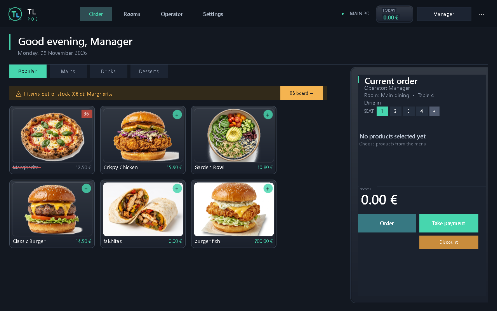
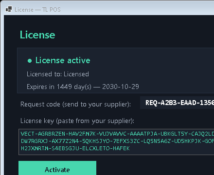
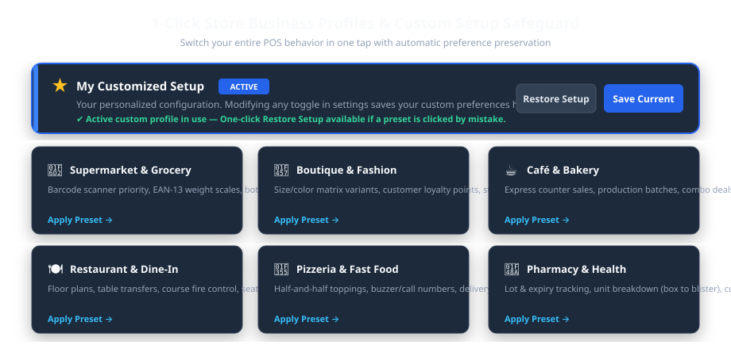
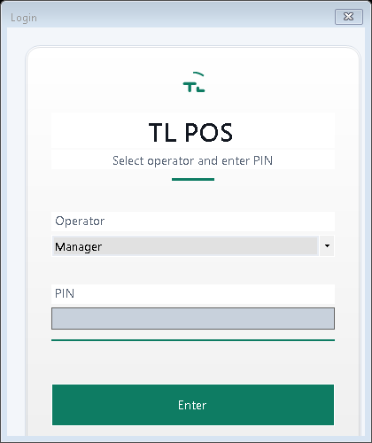
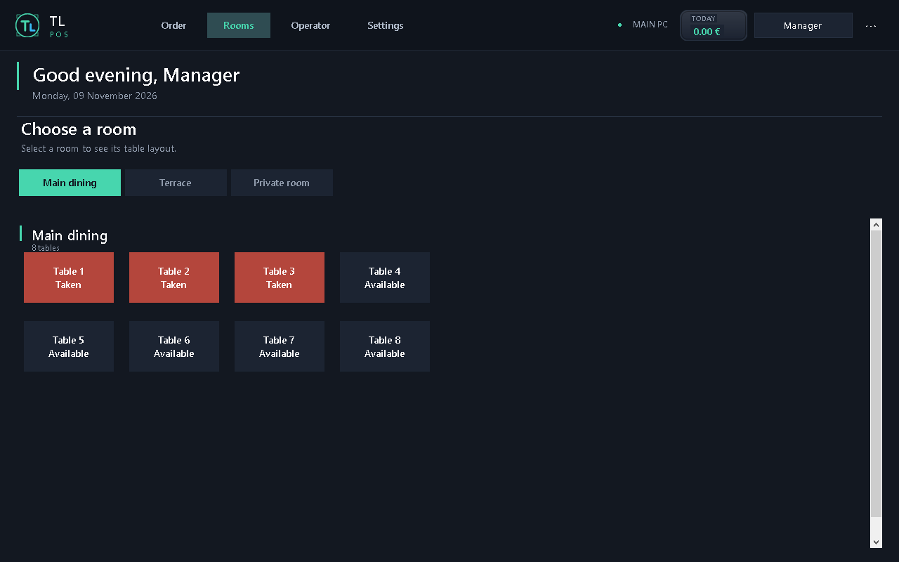
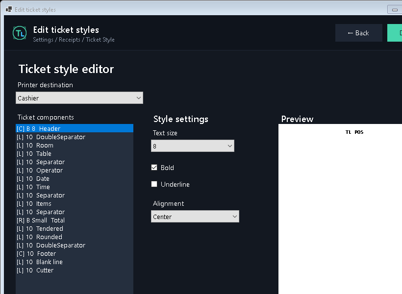
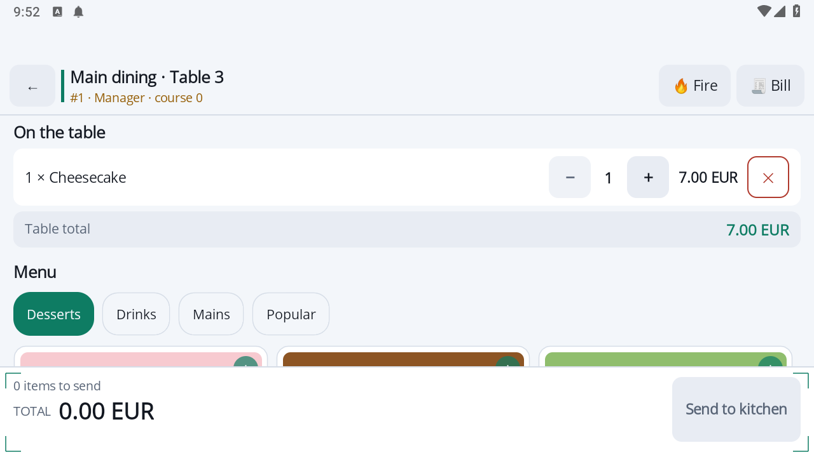
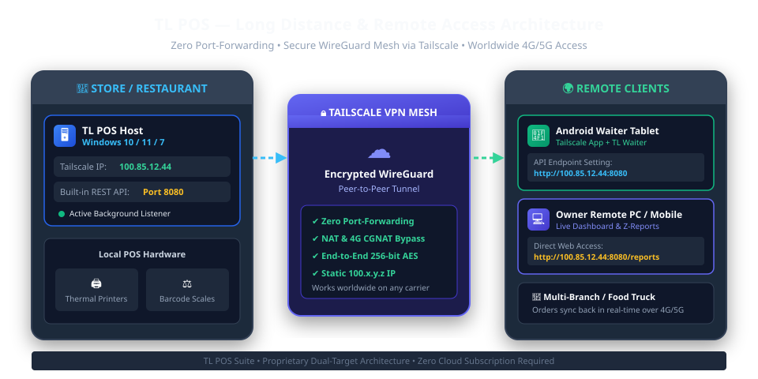

# TL POS Suite — Official Administrator & User Manual
**Version 1.2.0 Enterprise** | Author & Lead Developer: Lounes Tinouche (TL) | English Edition

---

## Table of Contents
1. [System Overview & Architecture](#01-system-overview--architecture)
2. [Installation & System Requirements](#02-installation--system-requirements)
3. [Cryptographic Licensing & Activation](#03-cryptographic-licensing--activation)
4. [1-Click Store Profiles & Custom Safeguard](#04-1-click-store-profiles--custom-safeguard)
5. [Daily Cashier & Restaurant Operations](#05-daily-cashier--restaurant-operations)
6. [Hardware: Printers, Scales & Ticket Designer](#06-hardware-printers-scales--ticket-designer)
7. [Android Mobile Waiter App Integration](#07-android-mobile-waiter-app-integration)
8. [Long-Distance Remote Access via Tailscale VPN](#08-long-distance-remote-access-via-tailscale-vpn)
9. [Inventory, Recipes & Ingredient Tracking](#09-inventory-recipes--ingredient-tracking)
10. [Data Backup, Maintenance & Troubleshooting](#10-data-backup-maintenance--troubleshooting)

---

## 01. System Overview & Architecture

**TL POS** is a mission-critical Point of Sale suite designed specifically for demanding hospitality, retail, and food-service environments. The application is built around an ultra-reliable, **offline-first** philosophy: it operates with zero reliance on cloud connections, local SQL servers, or fragile database services.

### The TL POS Ecosystem
* **Main Windows POS Terminal:** The central powerhouse controlling billing, ticket generation, cash drawers, inventory, and end-of-day financial audit reports.
* **Android Waiter App:** A high-productivity mobile companion built on .NET MAUI, allowing floor staff to take orders, customize dish modifiers, and fire tickets directly to the kitchen from tables.
* **Self-Ordering Kiosk Totem:** A full-screen customer terminal supporting visual menus, automated ticket printing, and kiosk order queues.
* **Embedded Micro-Server (Port 8080):** Built directly into the Windows POS, this high-throughput HTTP REST engine enables instant wireless sync with tablets without requiring IIS, Apache, or Docker.

### Dual-Target Operating System Compatibility
| Edition | Target Platform | Runtime Engine | Ideal Hardware Deployment |
|---|---|---|---|
| **Modern x64** | Windows 10, Windows 11 (64-bit) | .NET 10.0 Native Windows | Modern touch POS terminals, Intel Core / Celeron J6412, all-in-one capacitive screens. |
| **Legacy x86/x64** | Windows 7 SP1, Windows 8.1, POSReady 7 | .NET Framework 4.8 Native | Vintage retail hardware, resistive touch terminals, Atom D525, legacy cash registers. |



---

## 02. Installation & System Requirements

### Minimum Hardware Requirements
* **Processor:** Dual-Core 1.8 GHz or higher (Intel Celeron, Core i3/i5/i7, AMD Ryzen).
* **RAM:** 2 GB minimum (4 GB or more recommended).
* **Storage:** 250 MB free disk space for the application; SSD recommended for sub-second boot times.
* **Display:** 1024×768 resolution minimum (optimally 1920×1080 touch display).
* **Operating System:** Windows 7 SP1 with .NET 4.8, or Windows 10/11 (64-bit).

### Step-by-Step Windows Installation
1. **Acquire the Release Archive:** Obtain the official ZIP package matching your operating system:
   * `publish-win10-x64.zip` for modern Windows 10/11 terminals.
   * `publish-win7.zip` for Windows 7 SP1 terminals.
2. **Extract to Application Directory:** Extract the contents to a permanent root folder, preferably `C:\TLPOS\` or `D:\TLPOS\`. Avoid running directly inside temporary download directories.
3. **Verify Prerequisites:**
   * On Windows 7 SP1: Ensure *Microsoft .NET Framework 4.8* is installed.
   * On Windows 10/11: The application ships as a self-contained runtime; no external .NET installation is required.
4. **Create Desktop Shortcut:** Right-click `TL POS.exe` → *Send to* → *Desktop (create shortcut)*.
5. **Run as Administrator (First Launch):** Right-click the shortcut and select *Run as administrator* to allow Windows to register network listener permissions for the embedded mobile server.

> **Zero-Registry Portability:** TL POS is 100% portable. It writes no entries into the Windows Registry. All configuration, product catalogs, customer balances, and sales archives reside strictly inside the `client database\` subfolder.

---

## 03. Cryptographic Licensing & Activation

TL POS is secured by an industrial-grade **Elliptic Curve Digital Signature Algorithm (ECDSA)** engine. Each license is tied to the unique hardware signature of the POS motherboard and storage controller, guaranteeing copy protection without requiring continuous internet connectivity.



### Activation Procedure
1. Upon launching the software for the first time on an unactivated terminal, the **Product Activation** dialog will appear automatically.
2. The dialog displays a unique 16-character **Terminal Machine Code** (e.g., `VEC-9A4F-82B1-C34E`).
3. Copy this code or take a photo and provide it to your TL POS distributor.
4. The distributor will provide a cryptographic license file named `license.dat`.
5. Click **Import License File** and browse to the supplied `license.dat`, or drop the file directly into the `client database\` directory.
6. The status badge immediately turns green (*Activated — Lifetime License*), unlocking all enterprise features.

---

## 04. 1-Click Store Profiles & Custom Safeguard

Rather than requiring hours of manually toggling hundreds of settings, TL POS features an intelligent **Business Profiles Engine**. A single click transforms the user interface, order flow, receipt formatting, and feature set to match your specific industry.



### The 6 Specialized Business Models
* **🛒 Supermarket & Grocery:** High-speed barcode scanner prioritization, EAN-13 weight scales, bottle deposits, multi-quantity barcode burst.
* **👗 Boutique & Fashion:** Size/Color matrix variants, customer loyalty accounts, store credit & layaway, seasonal discounts.
* **☕ Café & Bakery:** Express counter quick-sales, production batches, combo breakfast deals, dual take-away/dine-in VAT.
* **🍽️ Restaurant & Dine-In:** Visual room & table maps, table transfer, course management (Starter/Main/Dessert), bill splitting, Android tablet waiters.
* **🍕 Pizzeria & Fast Food:** Half-and-half pizza toppings, buzzer/call numbers on receipts, delivery driver dispatch, kitchen display monitors.
* **💊 Pharmacy & Health:** Lot numbers & expiry date tracking, blister unit breakdown (selling single blister from a box), customer insurance tabs.

### The Customized Setup Safeguard
> **Mistake-Proof Customization:** Whenever you manually tweak any setting (such as changing a tax rate or enabling a loyalty toggle), TL POS automatically saves your entire configuration into the **★ My Customized Setup** profile. If an employee accidentally clicks on a preset profile (e.g., clicking "Boutique" by mistake), you can simply click **Restore Setup** at the top of the Profiles page to immediately restore all your personalized parameters!

---

## 05. Daily Cashier & Restaurant Operations

### 1. Operator Login & Cash Float Opening
At the start of each work shift, the cashier selects their name and inputs their 4-digit security PIN on the touch numeric keypad. If the Cash Drawer feature is active, the system prompts for the initial opening cash float.



### 2. Taking Orders in Table Mode (Dine-In)
1. Click on the **Rooms / Tables** tab in the navigation rail.
2. Select the dining area (e.g., *Main Dining Room, Terrace, VIP Lounge*).
3. Green tables indicate available tables; orange/red tables indicate active dining guests.
4. Tap an available table to open the order pad.
5. Tap category pills and tap product cards to add items to the ticket basket.
6. Use the **Modifiers** sheet to select cooking temperatures or exclude ingredients.
7. Tap **Send to Kitchen**: The order is instantly dispatched to kitchen thermal printers or the Kitchen Display Screen (KDS).



### 3. Taking Orders in Express Counter Mode (Retail / Fast-Food)
In Express mode, the table map is bypassed. Scanning any barcode or tapping a product card opens a direct transaction:
* Scan item barcode → Press **Pay** → Enter cash received → Receipt prints automatically and the cash drawer kicks open.

### 4. End-of-Day Closing (X & Z Reports)
* **X-Report (Mid-day Audit):** Provides a reading of current sales totals, cash in drawer, and payment breakdowns without resetting the shift registers.
* **Z-Report (End-of-Day Closure):** Closes the business day, prints a tamper-evident financial audit slip, calculates cash discrepancies, and archives daily turnover to permanent financial history.

---

## 06. Hardware: Printers, Scales & Ticket Designer

### 1. Thermal Receipt Printers Configuration
TL POS supports direct hardware communication via **Raw ESC/POS commands** (via USB or network IP) as well as the standard **Windows Print Driver** system.



> **Spooler Graceful Defense:** If Windows Print Spooler service is stopped or a printer cable is unplugged, TL POS does not crash. It displays a clear diagnostic warning and logs the event without halting active sales.

### 2. Barcode Scales & Embedded EAN-13 Weighing
For butcher shops, produce sections, and delicatessens, TL POS features automatic parsing of **EAN-13 weight-embedded barcodes** (prefixes `20`, `21`, `22`, `28`, `29`):
```
Barcode Format:  [22][PLU (4 digits)][Weight/Price (5 digits)][Check Digit]
Example:         22 0105 01250 8
Decoding:        Item: Premium Ribeye (#105) | Weight: 1.250 kg | Automatically priced!
```

---

## 07. Android Mobile Waiter App Integration

The **TL Waiter** companion app turns any Android tablet or smartphone into an ultra-fast order terminal. Floor staff can take orders at the customer's table, submit orders to kitchen printers, and print check bills without ever walking back to the counter.



### Connecting Waiter Tablets (Local Network)
1. Ensure the Windows POS computer and Android tablets are connected to the same Wi-Fi router.
2. On the Windows POS, open **Settings → Network / Tablet Connection**.
3. A pairing QR code and local IP address (e.g., `http://192.168.1.50:8080`) will appear.
4. Launch the TL Waiter app on the Android tablet.
5. Tap **Scan QR to Connect** (or manually enter the POS IP address and the secure API key).
6. The tablet is paired instantly.

---

## 08. Long-Distance Remote Access via Tailscale VPN

Using **Tailscale**, you can connect remote waiter tablets across different floors, outdoor terraces, separate buildings, food trucks, or allow restaurant owners to monitor live sales from home—**without touching router firewall settings or buying expensive static public IP addresses**.



### Why Tailscale is the Ultimate Solution for POS
* **Zero Port Forwarding:** You never have to open ports on your restaurant router. Your network remains completely immune to internet scanners and hackers.
* **Bypasses 4G/5G CGNAT:** Works seamlessly on mobile data SIM cards (where internet providers block incoming connections).
* **End-to-End Encryption:** Powered by WireGuard® (state-of-the-art cryptography, ChaCha20/Poly1305 authentication).
* **Permanent 100.x.y.z Static IP:** Tailscale assigns a permanent IP to each machine that never changes.
* **100% Free:** Free tier for up to 100 devices.

### Step 1: Installing Tailscale on the Main Windows POS Host
1. Visit [tailscale.com](https://tailscale.com) and create a free account.
2. Download and install **Tailscale for Windows** on your main POS terminal.
3. Click the Tailscale tray icon and log in with your account.
4. Once connected, right-click the Tailscale tray icon and copy your terminal's unique **100.x.y.z IP address** (e.g., `100.85.12.44`).
5. Ensure the embedded micro-server is enabled in TL POS (*Settings → Advanced Features → Enable REST API: YES*).

### Step 2: Connecting the Android Waiter Tablet Over 4G/5G
1. Install the official **Tailscale** application from Google Play Store on the Android tablet.
2. Log into the **exact same Tailscale account** as the POS machine.
3. Tap **Connect** in the Tailscale app.
4. Launch **TL Waiter**.
5. In the server connection field, enter the POS Tailscale IP: `http://100.85.12.44:8080`
6. Enter your secure API key and tap **Connect**. The waiter can now take orders from an outdoor beach terrace, rooftop lounge, or parking lot hundreds of meters away over 4G/5G!

### Step 3: Remote Owner Live Dashboard (From Home or Mobile Phone)
1. Install Tailscale on the owner's smartphone or home laptop and connect to the account.
2. Open Google Chrome, Safari, or Microsoft Edge.
3. Navigate to: `http://100.85.12.44:8080/reports`
4. The live web dashboard displays real-time gross revenue, sales by category, current open orders, and cashier audit logs.

---

## 09. Inventory, Recipes & Ingredient Tracking

### 1. Simple Stock Tracking
For retail and packaged goods, set the stock level directly on the product card. Each sale deducts 1 unit. Set low-stock alert thresholds.

### 2. Recipe-Based Ingredient Deductions (Restaurants & Pizzerias)
For food and beverage items, you can define composite recipes. When a dish is sold, the exact raw materials are subtracted from raw inventory:
* **Example: Pizza Margherita**
  * Dough ball: 1 unit
  * Tomato sauce: 80 grams
  * Mozzarella cheese: 120 grams
  * Fresh basil: 3 leaves

Selling 10 Margherita pizzas automatically deducts 1.2 kg of mozzarella and 800 g of sauce from your stock warehouse!

---

## 10. Data Backup, Maintenance & Troubleshooting

### 1. Safe Data Backup in 10 Seconds
1. Close TL POS.
2. Open the application directory (`C:\TLPOS\`).
3. Copy the entire **`client database\`** folder to an external USB flash drive or secure cloud storage.

### 2. Troubleshooting Common Issues
| Symptom | Root Cause | Solution |
|---|---|---|
| **"RPC Server Unavailable" when managing printers** | Windows Print Spooler service stopped. | Press `Win + R`, type `services.msc`, locate **Print Spooler**, right-click and select **Start**. |
| **Android Tablet cannot connect to POS** | Windows Firewall is blocking port 8080. | In Windows Defender Firewall, allow port 8080 incoming TCP, or simply use Tailscale (Section 08). |
| **Cash drawer does not kick open** | Incorrect pulse pin. | In *Manage Printers*, switch between Epson Pin 2 and Pin 5 pulse. |
| **Barcode scanner adds extra digits** | Scanner prefix/suffix configuration. | Scan the reset barcode in your scanner manual to restore standard USB HID Keyboard wedge mode with CR/Enter suffix. |

---
*© 2026 TL POS Suite • Official Documentation*
