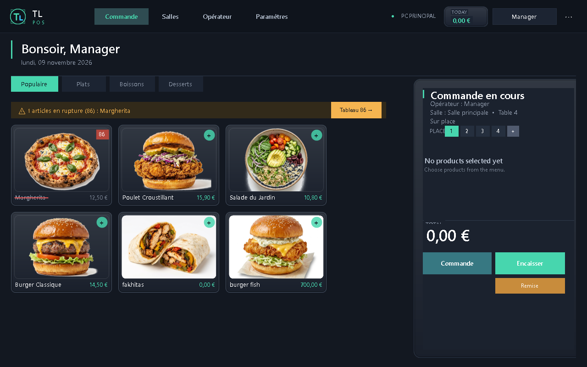
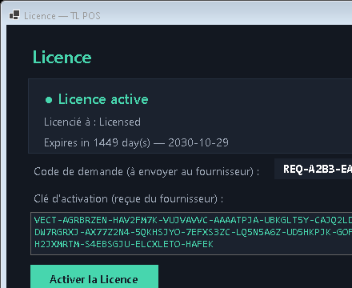
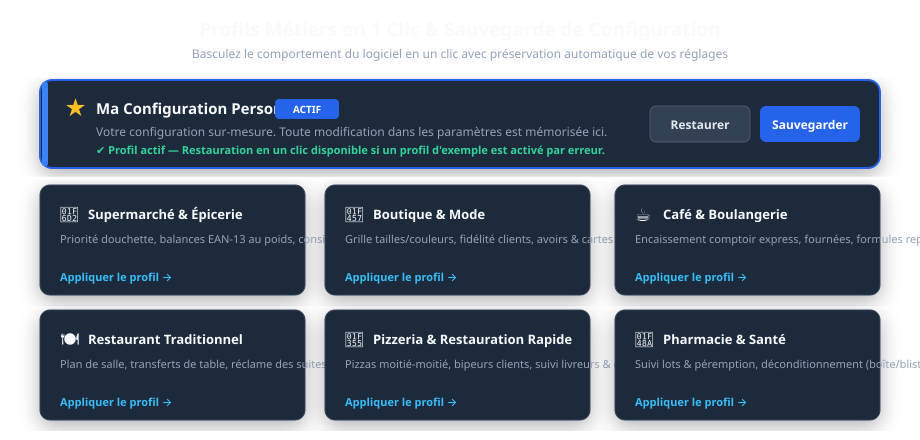
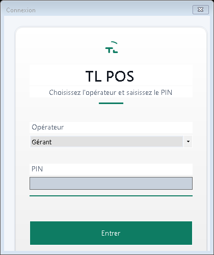
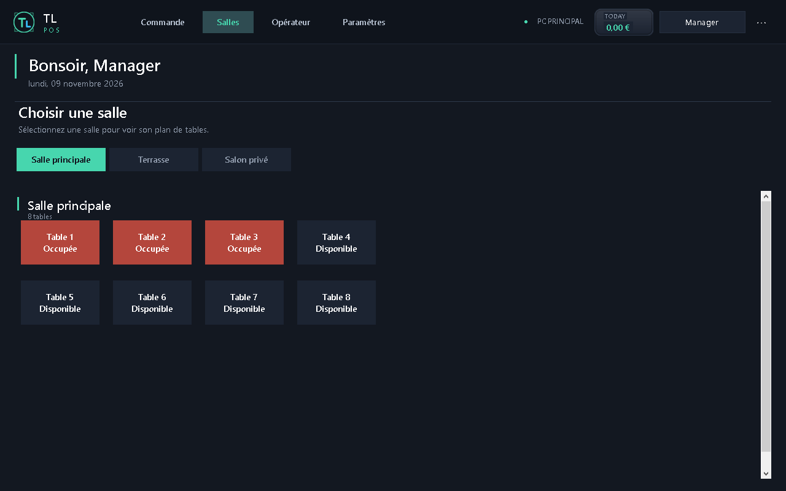
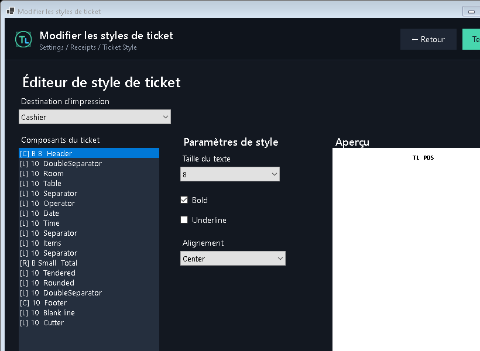
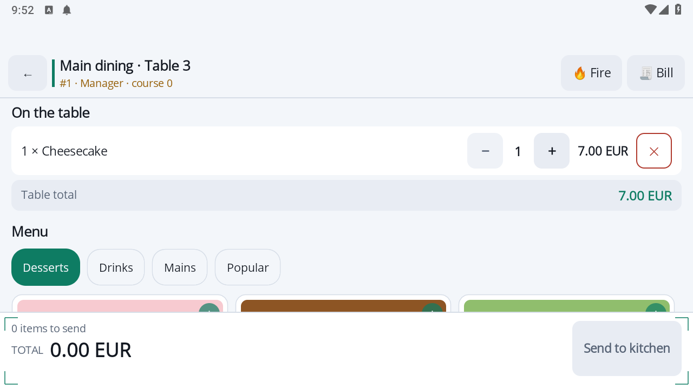
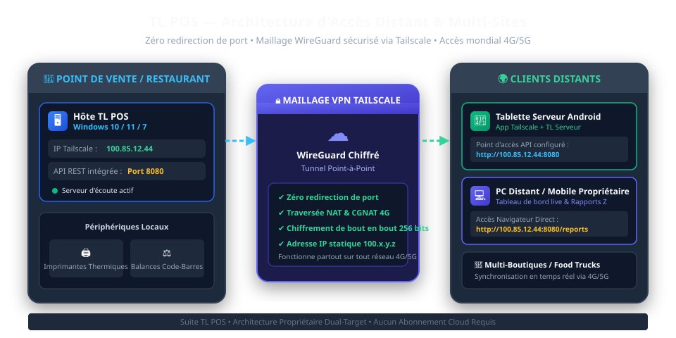

# Suite TL POS — Manuel Officiel d'Utilisation & d'Administration

**Auteur & Concepteur :** Lounes Tinouche (TL)  
**Version :** TL POS v2.6 Pro (Édition Multi-Postes)  
**Plateformes supportées :** Windows 10, Windows 11, Windows 7 SP1 / POSReady, Android 8+  

---

## Sommaire
- [01. Présentation Générale & Architecture Système](#01-présentation-générale--architecture-système)
- [02. Installation & Prérequis Matériels](#02-installation--prérequis-matériels)
- [03. Activation de la Licence Cryptographique (ECDSA)](#03-activation-de-la-licence-cryptographique-ecdsa)
- [04. Profils Métiers en 1 Clic & Sauvegarde Personnalisée](#04-profils-métiers-en-1-clic--sauvegarde-personnalisée)
- [05. Opérations Quotidiennes de Caisse & Restauration](#05-opérations-quotidiennes-de-caisse--restauration)
- [06. Matériel : Imprimantes, Balances & Éditeur de Ticket](#06-matériel--imprimantes-balances--éditeur-de-ticket)
- [07. Intégration des Tablettes Serveurs Android (TL Serveur)](#07-intégration-des-tablettes-serveurs-android-tl-serveur)
- [08. Accès Distant Longue Distance & Multi-Sites via Tailscale VPN](#08-accès-distant-longue-distance--multi-sites-via-tailscale-vpn)
- [09. Gestion des Stocks, Fiches Techniques & Ingrédients](#09-gestion-des-stocks-fiches-techniques--ingrédients)
- [10. Sauvegarde, Maintenance & Guide de Dépannage](#10-sauvegarde-maintenance--guide-de-dépannage)

---

## 01. Présentation Générale & Architecture Système

**TL POS** est une solution complète d'encaissement et de gestion commerciale développée par **Lounes Tinouche (TL)**.
Conçue sans framework lourd, elle démarre en moins d'une seconde et offre une stabilité à toute épreuve.

### Compatibilité Dual-Target
- **TL POS Win10/11 (`net10.0-windows`) :** Version 64 bits ultra-rapide (~45 Mo RAM) pour PC tactiles modernes.
- **TL POS Win7 (`net48`) :** Version optimisée (~25 Mo RAM) compatible avec Windows 7 SP1 et POSReady 7.
- **TL Serveur Android :** Application mobile .NET MAUI fluide pour la prise de commande en salle et terrasse.

### Thèmes & Niveaux Graphiques
- **Thème Clair / Thème Sombre :** Basculement instantané pour s'adapter à la luminosité du magasin ou du restaurant.
- **Qualité Haute (High Tier) :** Dégradés modernes, ombres douces et transitions fluides à 60 FPS.
- **Qualité Légère (Lite Tier) :** Mode 100% à plat sans timers d'animation, préservant les performances des processeurs modestes.

---

## 02. Installation & Prérequis Matériels

### Configuration Recommandée
- **Processeur :** Intel Core i3 / i5 ou AMD Ryzen (Fonctionne également sur Celeron / Core 2 Duo).
- **Mémoire Vive :** 2 Go minimum, 4 Go recommandé.
- **Disque :** 200 Mo d'espace libre (SSD recommandé pour un lancement instantané).
- **Écran :** Résolution 1024x768 ou 1920x1080 (tactile ou souris classique).

### Installation sous Windows
1. Téléchargez ou copiez le dossier d'installation sur votre machine (`C:\TL POS`).
2. Pour Windows 10/11, lancez `publish-win10-x64\TL POS.exe`. Pour Windows 7, lancez `publish-win7\TL POS.exe`.
3. Créez un raccourci sur le Bureau. Aucune installation de base de données externe (SQL Server/MySQL) n'est requise.

---

## 03. Activation de la Licence Cryptographique (ECDSA)

TL POS intègre une protection par signature cryptographique sur courbes elliptiques (ECDSA P-256 / SHA-256) :
1. Au premier lancement, la fenêtre d'activation affiche votre **Machine ID** unique (ex: `A1B2-C3D4-E5F6-7890`).
2. Cliquez sur **Copier l'identifiant** et transmettez-le à votre distributeur agréé ou à **Lounes Tinouche (TL)**.
3. Renseignez le nom de votre commerce et collez la clé reçue.
4. Cliquez sur **Activer la Licence**. Le fichier `license.dat` est créé et votre caisse est débloquée à vie.

---

## 04. Profils Métiers en 1 Clic & Sauvegarde Personnalisée

Basculez l'intégralité du comportement de votre caisse en 1 clic selon votre domaine d'activité :
- 🛒 **Supermarché & Épicerie :** Priorité douchette, décodage balances poids EAN-13, encaissement rapide.
- 👗 **Boutique & Prêt-à-Porter :** Grille tailles/couleurs, fidélité clients, gestion des retours et avoirs.
- ☕ **Café & Boulangerie :** Vente comptoir express, formules repas, ventilation TVA sur place/emporter.
- 🍽️ **Restaurant Traditionnel :** Plan de salle, transfert de tables, réclame des suites, partage de note.
- 🍕 **Pizzeria & Fast Food :** Moitié-moitié, bipeurs clients, suivi des livreurs, écran cuisine KDS.
- 💊 **Pharmacie & Parapharmacie :** Lots & péremption, déconditionnement (boîte vers blister), tiers payant.

**Bouclier de Sauvegarde Personnalisée :** Vos réglages personnels sont automatiquement préservés. Le bouton **Restaurer ma configuration** permet de revenir à tout moment à votre paramétrage personnalisé.

---

## 05. Opérations Quotidiennes de Caisse & Restauration

1. **Ouverture & Fond de Caisse :** Connexion opérateur par code PIN à 4 chiffres et saisie du montant d'espèces en tiroir.

2. **Prise de Commande Table :** Choix de la zone, sélection de la table libre, ajout d'articles avec cuisson et options, envoi direct en cuisine.
3. **Vente Comptoir :** Scan immédiat d'articles au lecteur code-barres et encaissement direct.
4. **Paiement & Rendu Monnaie :** Prise en charge espèces (calcul du rendu), carte bancaire, chèque ou paiement fractionné.
5. **Clôture de Caisse (Rapport Z) :** Impression du récapitulatif fiscal journalier, archivage des ventes et remise à zéro pour le lendemain.

---

## 06. Matériel : Imprimantes, Balances & Éditeur de Ticket

- **Imprimantes Thermiques ESC/POS :** Prise en charge des imprimantes 80mm et 58mm en USB, Série, Réseau Ethernet et Wi-Fi. Protection intégrée contre l'arrêt du spouleur Windows.

- **Concepteur Visuel de Ticket (WYSIWYG) :** Personnalisation graphique avec logo, en-tête, pied de page, coordonnées et massicot automatique.
- **Balances Code-Barres EAN-13 :** Décodage automatique des étiquettes poids variable (préfixes 20, 21, 22, 23, 24, 28) avec calcul immédiat du poids et du montant total.
- **Tiroirs-Caisses RJ11 :** Déclenchement automatique par impulsion ESC/POS lors des règlements espèces.

---

## 07. Intégration des Tablettes Serveurs Android (TL Serveur)

L'application **TL Serveur** permet aux serveurs de prendre les commandes directement à table :
- L'ordinateur de caisse Windows écoute sur le port `8080`.
- Connectez la tablette au réseau Wi-Fi local.
- Dans l'application TL Serveur, indiquez l'adresse IP de la caisse (ex: `http://192.168.1.50:8080`).
- Les tables, menus et commandes se synchronisent instantanément.

---

## 08. Accès Distant Longue Distance & Multi-Sites via Tailscale VPN

Pour connecter des tablettes serveurs à distance (terrasse extérieure, food trucks) ou pour surveiller votre établissement depuis chez vous :
1. **Installez Tailscale** sur le PC Windows principal : il reçoit une IP fixe privée du type `100.x.y.z`.
2. **Installez Tailscale** sur la tablette ou smartphone distant (4G/5G).
3. Entrez l'IP Tailscale dans TL Serveur (`http://100.x.y.z:8080`).
4. **Zéro configuration de routeur :** Aucun port à ouvrir (zéro port forwarding), traversée totale des routeurs 4G (CGNAT) et chiffrement militaire WireGuard.
5. **Tableau de Bord Propriétaire :** Accédez aux rapports en temps réel depuis votre téléphone à l'adresse `http://100.x.y.z:8080/reports`.

---

## 09. Gestion des Stocks, Fiches Techniques & Ingrédients

- **Articles Simples :** Décrémentation automatique du stock par quantité vendue et seuil d'alerte de réapprovisionnement.
- **Fiches Techniques Recettes :** Déduction automatique des ingrédients élémentaires (ex: une Pizza Reine déstocke 1 pâton, 80g de sauce tomate, 120g de mozzarella, 70g de jambon et 50g de champignons).

---

## 10. Sauvegarde, Maintenance & Guide de Dépannage

### Sauvegarde en 10 Secondes
Copiez simplement le dossier `client database\` sur une clé USB. Toutes vos données sont sauvegardées sans manipulation SQL.

### Dépannage Rapide
- **« Le serveur RPC n'est pas disponible » :** Le service Windows Spooler est arrêté. Ouvrez l'invite de commande en administrateur et tapez `net start spooler`.
- **Tiroir-caisse immobile :** Vérifiez que le câble RJ11 est branché sur l'imprimante thermique sur la prise marquée *DK*.
- **Tablette non connectée :** Autorisez le port TCP `8080` dans le Pare-feu Windows de la caisse.

---
*(c) 2026 TL POS Suite — Lounes Tinouche (TL). Tous droits réservés.*
